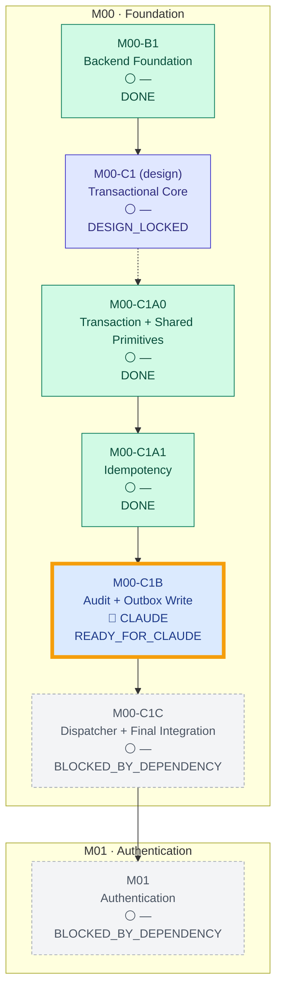

<!-- AUTO-GENERATED — DO NOT EDIT MANUALLY. Source: docs/progress/plan.yml + GitHub. Generator: scripts/generate-progress.mjs -->

# 11Ship — Project Progress

> **AUTO-GENERATED — DO NOT EDIT MANUALLY**
>
> The plan lives in [`docs/progress/plan.yml`](progress/plan.yml); the status comes from GitHub (merged PRs, draft/open/closed state, labels, head SHA, required checks, dependencies). Nobody, human or AI, can mark a task DONE by writing it down. See [how states are derived](progress/README.md).
> Data as of main code `93323f7` (HEAD is a docs-only progress-bot commit; CI is read from this code commit) · main CI: ✅ PASS

## 🎯 CURRENT FOCUS

| | |
|---|---|
| **Task** | **M00-C1B — Audit + Outbox Write** |
| **Status** | 🟦 `READY_FOR_CLAUDE` |
| **Current owner** | 🔵 **CLAUDE** |
| **ChatGPT** | Waiting for Claude implementation before review |
| **Claude** | Ready to implement |
| **Owner** | No action needed |
| **Blocked by** | None |
| **Next gate** | Implementation PR (agent:claude, type:implementation, module label) + required CI green |

## Progress

Weighted by task weight in the plan (each leaf task = 1 unless stated). Commits, lines of code and cancelled PRs never count. Percentages are rounded down.

| Scope | Done / total |
|---|---|
| Current milestone — M00 Foundation | 3 / 5 (60%) |
| Overall — planned tasks only (roadmap not final) | 3 / 6 (50%) |
| Module M01 Authentication | 0 / 1 (0%) |

## Progress tree

Solid arrows are dependencies, dotted arrows are parent → first child. The thick amber outline is the current focus.

## Task details

| Task | Status | Current owner | PR | CI | Head | Dependency | Next action |
|---|---|---|---|---|---|---|---|
| M00-B1 · Backend Foundation | ✅ DONE | — | [#2](https://github.com/trungtn87/11ship/pull/2) | ✅ PASS | `55c5d81` | — | — |
| **M00-C1** design · Transactional Core | 🔒 DESIGN_LOCKED | — | [#3](https://github.com/trungtn87/11ship/pull/3) | ✅ PASS | `de82b15` | B1 DONE | Continue child tasks |
| &nbsp;&nbsp;M00-C1A0 · Transaction + Shared Primitives | ✅ DONE | — | [#4](https://github.com/trungtn87/11ship/pull/4) | ✅ PASS | `688e796` | — | — |
| &nbsp;&nbsp;M00-C1A1 · Idempotency | ✅ DONE | — | [#6](https://github.com/trungtn87/11ship/pull/6) | ✅ PASS | `44c0fa7` | C1A0 DONE | — |
| &nbsp;&nbsp;M00-C1B · Audit + Outbox Write | 🟦 READY_FOR_CLAUDE | Claude | — | — | main code `93323f7` | C1A1 DONE | Claude implement |
| &nbsp;&nbsp;M00-C1C · Dispatcher + Final Integration | ⛔ BLOCKED_BY_DEPENDENCY | — | — | — | — | C1B READY_FOR_CLAUDE | Wait for C1B |
| M01 · Authentication | ⛔ BLOCKED_BY_DEPENDENCY | — | — | — | — | C1C BLOCKED_BY_DEPENDENCY | Wait for C1C |

## Pull request ledger

How every PR is treated. A PR counts only through explicit metadata (labels, or a number pinned in the plan), never through its title, body or author.

| PR | Lifecycle | Task | Role | CI on head | Head | Treated as |
|---|---|---|---|---|---|---|
| [#1](https://github.com/trungtn87/11ship/pull/1) Bước 5.1–5.2: kiểm tra repo, chốt nền và bàn giao M00-B1 | MERGED | M00-B1 | design | — | `a07bbf7` | counted |
| [#2](https://github.com/trungtn87/11ship/pull/2) feat(m00-b1): backend foundation — F01–F09 verified PASS | MERGED | M00-B1 | implementation | ✅ PASS | `55c5d81` | counted |
| [#3](https://github.com/trungtn87/11ship/pull/3) docs(m00-c1): transactional core design | MERGED | M00-C1 | design | ✅ PASS | `de82b15` | counted |
| [#4](https://github.com/trungtn87/11ship/pull/4) M00-C1A0: transaction lifecycle and shared primitives | MERGED | M00-C1A0 | implementation | ✅ PASS | `688e796` | counted |
| [#5](https://github.com/trungtn87/11ship/pull/5) feat(m00-c1a1): idempotency executor, replay and cleanup | 🚫 CANCELLED / IGNORED | M00-C1A1 | implementation | ✅ PASS | `e1c67b1` | 🚫 not counted (cancelled) — Implementation opened by ChatGPT against the workflow, closed without merge. Not accepted. |
| [#6](https://github.com/trungtn87/11ship/pull/6) M00-C1A1: Idempotency (draft) | MERGED | M00-C1A1 | implementation | ✅ PASS | `44c0fa7` | counted |
| [#7](https://github.com/trungtn87/11ship/pull/7) docs(m03-m04): financial consistency, withdrawal reconcilia… | DRAFT | — | — | ✅ PASS | `645a59b` | ⚠️ not counted — no usable metadata (missing module:&lt;task id&gt;, type:design¦implementation¦review-fix, agent:*); PR not c… |
| [#8](https://github.com/trungtn87/11ship/pull/8) chore(progress): GitHub-derived project progress dashboard | MERGED | — | infra | — | `1ce1e50` | out of plan — Out of plan (type:infra) |
| [#9](https://github.com/trungtn87/11ship/pull/9) M00-C1B: Audit + Outbox write primitives | MERGED | — | — | — | `b418fd2` | ⚠️ not counted — no usable metadata (missing module:&lt;task id&gt;, type:design¦implementation¦review-fix, agent:*); PR not c… |
| [#10](https://github.com/trungtn87/11ship/pull/10) feat(outbox): M00-C1C outbox dispatcher + final | MERGED | — | — | — | `172931b` | ⚠️ not counted — no usable metadata (missing module:&lt;task id&gt;, type:design¦implementation¦review-fix, agent:*); PR not c… |
| [#11](https://github.com/trungtn87/11ship/pull/11) docs(m01-a1): lock Auth Core implementation contract | MERGED | — | — | — | `a17935f` | ⚠️ not counted — no usable metadata (missing module:&lt;task id&gt;, type:design¦implementation¦review-fix, agent:*); PR not c… |
| [#12](https://github.com/trungtn87/11ship/pull/12) feat(auth): M01-A1 Auth Core (READY CANDIDATE, CI pending l… | DRAFT | — | — | ❌ FAIL | `b2e2280` | ⚠️ not counted — no usable metadata (missing module:&lt;task id&gt;, type:design¦implementation¦review-fix, agent:*); PR not c… |

## ⚠️ Attention

- `UNCLASSIFIED_PR` PR #7: no usable metadata (missing module:&lt;task id&gt;, type:design¦implementation¦review-fix, agent:*); PR not counted. State is never inferred from titles, bodies or authors.
- `UNCLASSIFIED_PR` PR #12: no usable metadata (missing module:&lt;task id&gt;, type:design¦implementation¦review-fix, agent:*); PR not counted. State is never inferred from titles, bodies or authors.

## Workflow

`PLAN → CHATGPT DESIGN → DESIGN LOCKED → READY FOR CLAUDE → CLAUDE CODING → CI → WAITING CHATGPT REVIEW → CHATGPT REVIEW → READY TO MERGE → MERGED / LOCKED → next task`

ChatGPT designs and reviews, Claude implements and tests, the Owner locks decisions and merges. Nothing is merged automatically.
