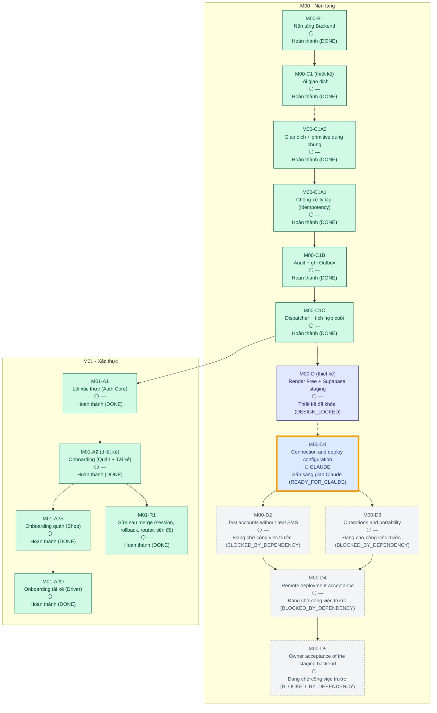

<!-- AUTO-GENERATED — DO NOT EDIT MANUALLY. Source: docs/progress/plan.yml + GitHub. Generator: scripts/generate-progress.mjs -->

# 11Ship — Tiến độ dự án

> **TỰ ĐỘNG TẠO — KHÔNG SỬA THỦ CÔNG**
>
> Kế hoạch nằm trong [`docs/progress/plan.yml`](progress/plan.yml); trạng thái được suy ra từ GitHub (PR đã merge, draft/open/closed, label, head SHA, required check và dependency). Không ai, kể cả người hay AI, có thể tự ghi một task thành HOÀN THÀNH. Xem [cách suy ra trạng thái](progress/README.md).
> Dữ liệu theo mã main `d557681` (HEAD là commit progress-bot chỉ sửa tài liệu; CI được đọc từ commit mã này) · CI main: ⏳ Đang chạy (`RUNNING`)

## 🎯 VIỆC ĐANG LÀM

| | |
|---|---|
| **Task** | **M00-D1 — Connection and deploy configuration** |
| **Trạng thái** | 🟦 Sẵn sàng giao Claude (`READY_FOR_CLAUDE`) |
| **Người phụ trách** | 🔵 **CLAUDE** |
| **ChatGPT** | Chờ Claude triển khai trước khi kiểm tra |
| **Claude** | Sẵn sàng triển khai |
| **Chủ dự án** | Không cần thao tác |
| **Đang bị chặn bởi** | Không |
| **Điều kiện sang bước tiếp** | PR triển khai (agent:claude, type:implementation, module label) + required CI xanh |

## Tiến độ

Tính theo trọng số task trong kế hoạch (mỗi task lá = 1 nếu không ghi khác). Commit, số dòng code và PR đã hủy không được tính. Phần trăm được làm tròn xuống.

| Phạm vi | Hoàn thành / tổng |
|---|---|
| Milestone hiện tại — M00 Nền tảng | 5 / 10 (50%) |
| Toàn bộ — chỉ tính task đã lập kế hoạch (roadmap chưa chốt hết) | 9 / 14 (64%) |
| Module M01 Xác thực | 4 / 4 (100%) |

## Cây tiến độ

Mũi tên liền là dependency, mũi tên nét đứt là task cha → task con đầu tiên. Viền vàng đậm là việc đang làm.

## Chi tiết công việc

| Task | Trạng thái | Người phụ trách | PR | CI | Head | Dependency | Việc tiếp theo |
|---|---|---|---|---|---|---|---|
| M00-B1 · Nền tảng Backend | ✅ Hoàn thành (`DONE`) | — | [#2](https://github.com/trungtn87/11ship/pull/2) | ✅ Đạt (`PASS`) | `55c5d81` | — | — |
| **M00-C1** thiết kế · Lõi giao dịch | ✅ Hoàn thành (`DONE`) | — | [#3](https://github.com/trungtn87/11ship/pull/3) | ✅ Đạt (`PASS`) | `de82b15` | B1 Hoàn thành (DONE) | — |
| &nbsp;&nbsp;M00-C1A0 · Giao dịch + primitive dùng chung | ✅ Hoàn thành (`DONE`) | — | [#4](https://github.com/trungtn87/11ship/pull/4) | ✅ Đạt (`PASS`) | `688e796` | — | — |
| &nbsp;&nbsp;M00-C1A1 · Chống xử lý lặp (Idempotency) | ✅ Hoàn thành (`DONE`) | — | [#6](https://github.com/trungtn87/11ship/pull/6) | ✅ Đạt (`PASS`) | `44c0fa7` | C1A0 Hoàn thành (DONE) | — |
| &nbsp;&nbsp;M00-C1B · Audit + ghi Outbox | ✅ Hoàn thành (`DONE`) | — | [#9](https://github.com/trungtn87/11ship/pull/9) | ✅ Đạt (`PASS`) | `b418fd2` | C1A1 Hoàn thành (DONE) | — |
| &nbsp;&nbsp;M00-C1C · Dispatcher + tích hợp cuối | ✅ Hoàn thành (`DONE`) | — | [#10](https://github.com/trungtn87/11ship/pull/10) | ✅ Đạt (`PASS`) | `172931b` | C1B Hoàn thành (DONE) | — |
| M01-A1 · Lõi xác thực (Auth Core) | ✅ Hoàn thành (`DONE`) | — | [#12](https://github.com/trungtn87/11ship/pull/12) | ✅ Đạt (`PASS`) | `ef3afd4` | C1C Hoàn thành (DONE) | — |
| **M01-A2** thiết kế · Onboarding (Quán + Tài xế) | ✅ Hoàn thành (`DONE`) | — | [#15](https://github.com/trungtn87/11ship/pull/15) | ✅ Đạt (`PASS`) | `c329808` | A1 Hoàn thành (DONE) | — |
| &nbsp;&nbsp;M01-A2S · Onboarding quán (Shop) | ✅ Hoàn thành (`DONE`) | — | [#16](https://github.com/trungtn87/11ship/pull/16) | ✅ Đạt (`PASS`) | `620333f` | — | — |
| &nbsp;&nbsp;M01-A2D · Onboarding tài xế (Driver) | ✅ Hoàn thành (`DONE`) | — | [#17](https://github.com/trungtn87/11ship/pull/17) | ✅ Đạt (`PASS`) | `c37082a` | A2S Hoàn thành (DONE) | — |
| M01-R1 · Sửa sau merge (session, rollback, router, tiến độ) | ✅ Hoàn thành (`DONE`) | — | [#19](https://github.com/trungtn87/11ship/pull/19) | ✅ Đạt (`PASS`) | `cd0e6de` | A2 Hoàn thành (DONE) | — |
| **M00-D** thiết kế · Render Free + Supabase staging | 🔒 Thiết kế đã khóa (`DESIGN_LOCKED`) | — | [#22](https://github.com/trungtn87/11ship/pull/22) | ✅ Đạt (`PASS`) | `a846a68` | C1C Hoàn thành (DONE) | Tiếp tục các task con |
| &nbsp;&nbsp;M00-D1 · Connection and deploy configuration | 🟦 Sẵn sàng giao Claude (`READY_FOR_CLAUDE`) | Claude | — | — | mã main `d557681` | — | Claude triển khai |
| &nbsp;&nbsp;M00-D2 · Test accounts without real SMS | ⛔ Đang chờ công việc trước (`BLOCKED_BY_DEPENDENCY`) | — | — | — | — | D1 Sẵn sàng giao Claude (READY_FOR_CLAUDE) | Chờ D1 |
| &nbsp;&nbsp;M00-D3 · Operations and portability | ⛔ Đang chờ công việc trước (`BLOCKED_BY_DEPENDENCY`) | — | — | — | — | D1 Sẵn sàng giao Claude (READY_FOR_CLAUDE) | Chờ D1 |
| &nbsp;&nbsp;M00-D4 · Remote deployment acceptance | ⛔ Đang chờ công việc trước (`BLOCKED_BY_DEPENDENCY`) | — | — | — | — | D2 Đang chờ công việc trước (BLOCKED_BY_DEPENDENCY), D3 Đang chờ công việc trước (BLOCKED_BY_DEPENDENCY) | Chờ D2, D3 |
| &nbsp;&nbsp;M00-D5 · Owner acceptance of the staging backend | ⛔ Đang chờ công việc trước (`BLOCKED_BY_DEPENDENCY`) | — | — | — | — | D4 Đang chờ công việc trước (BLOCKED_BY_DEPENDENCY) | Chờ D4 |

## Danh sách Pull Request

Cách hệ thống xử lý từng PR. PR chỉ được tính qua metadata rõ ràng (label hoặc số PR được ghim trong kế hoạch), không bao giờ suy ra từ tiêu đề, nội dung hay tác giả.

| PR | Vòng đời | Task | Vai trò | CI trên head | Head | Cách tính |
|---|---|---|---|---|---|---|
| [#1](https://github.com/trungtn87/11ship/pull/1) Bước 5.1–5.2: kiểm tra repo, chốt nền và bàn giao M00-B1 | Đã merge (`MERGED`) | M00-B1 | thiết kế | — | `a07bbf7` | được tính |
| [#2](https://github.com/trungtn87/11ship/pull/2) feat(m00-b1): backend foundation — F01–F09 verified PASS | Đã merge (`MERGED`) | M00-B1 | triển khai | ✅ Đạt (`PASS`) | `55c5d81` | được tính |
| [#3](https://github.com/trungtn87/11ship/pull/3) docs(m00-c1): transactional core design | Đã merge (`MERGED`) | M00-C1 | thiết kế | ✅ Đạt (`PASS`) | `de82b15` | được tính |
| [#4](https://github.com/trungtn87/11ship/pull/4) M00-C1A0: transaction lifecycle and shared primitives | Đã merge (`MERGED`) | M00-C1A0 | triển khai | ✅ Đạt (`PASS`) | `688e796` | được tính |
| [#5](https://github.com/trungtn87/11ship/pull/5) feat(m00-c1a1): idempotency executor, replay and cleanup | 🚫 Đã hủy / bỏ qua (`CANCELLED / IGNORED`) | M00-C1A1 | triển khai | ✅ Đạt (`PASS`) | `e1c67b1` | 🚫 không tính (đã hủy) — PR triển khai do ChatGPT mở sai quy trình, đã đóng và không merge. Không được chấp nhận. |
| [#6](https://github.com/trungtn87/11ship/pull/6) M00-C1A1: Idempotency (draft) | Đã merge (`MERGED`) | M00-C1A1 | triển khai | ✅ Đạt (`PASS`) | `44c0fa7` | được tính |
| [#7](https://github.com/trungtn87/11ship/pull/7) docs(m03-m04): financial consistency, withdrawal reconcilia… | Bản nháp (`DRAFT`) | — | — | ✅ Đạt (`PASS`) | `645a59b` | ⚠️ không tính — thiếu metadata hợp lệ (thiếu module:&lt;task id&gt;, type:design¦implementation¦review-fix, agent:*); PR khôn… |
| [#8](https://github.com/trungtn87/11ship/pull/8) chore(progress): GitHub-derived project progress dashboard | Đã merge (`MERGED`) | — | hạ tầng | — | `1ce1e50` | ngoài kế hoạch — Ngoài kế hoạch (type:infra) |
| [#9](https://github.com/trungtn87/11ship/pull/9) M00-C1B: Audit + Outbox write primitives | Đã merge (`MERGED`) | M00-C1B | triển khai | ✅ Đạt (`PASS`) | `b418fd2` | được tính |
| [#10](https://github.com/trungtn87/11ship/pull/10) feat(outbox): M00-C1C outbox dispatcher + final | Đã merge (`MERGED`) | M00-C1C | triển khai | ✅ Đạt (`PASS`) | `172931b` | được tính |
| [#11](https://github.com/trungtn87/11ship/pull/11) docs(m01-a1): lock Auth Core implementation contract | Đã merge (`MERGED`) | M01-A1 | thiết kế | ✅ Đạt (`PASS`) | `a17935f` | được tính |
| [#12](https://github.com/trungtn87/11ship/pull/12) feat(auth): M01-A1 Auth Core (READY CANDIDATE) | Đã merge (`MERGED`) | M01-A1 | triển khai | ✅ Đạt (`PASS`) | `ef3afd4` | được tính |
| [#13](https://github.com/trungtn87/11ship/pull/13) chore(progress): Việt hóa dashboard tiến độ | Đã merge (`MERGED`) | — | hạ tầng | — | `25a62e9` | ngoài kế hoạch — Ngoài kế hoạch (type:infra) |
| [#14](https://github.com/trungtn87/11ship/pull/14) docs(ui): add Figma workflow and frontend UI gate | Đang mở (`OPEN`) | — | hạ tầng | ✅ Đạt (`PASS`) | `0d16d7b` | ngoài kế hoạch — Ngoài kế hoạch (type:infra) |
| [#15](https://github.com/trungtn87/11ship/pull/15) docs(m01-a2): lock onboarding contract and task split | Đã merge (`MERGED`) | M01-A2 | thiết kế | ✅ Đạt (`PASS`) | `c329808` | được tính |
| [#16](https://github.com/trungtn87/11ship/pull/16) feat(onboarding): M01-A2S shop onboarding | Đã merge (`MERGED`) | M01-A2S | triển khai | ✅ Đạt (`PASS`) | `620333f` | được tính |
| [#17](https://github.com/trungtn87/11ship/pull/17) feat(m01-a2d): DRIVER onboarding (no Driver service area) | Đã merge (`MERGED`) | M01-A2D | triển khai | ✅ Đạt (`PASS`) | `c37082a` | được tính |
| [#18](https://github.com/trungtn87/11ship/pull/18) docs(m02-a): hồ sơ quán và tự động hoạt động theo giờ | Đã merge (`MERGED`) | — | — | — | `207133b` | ⚠️ không tính — thiếu metadata hợp lệ (thiếu module:&lt;task id&gt;, type:design¦implementation¦review-fix, agent:*); PR khôn… |
| [#19](https://github.com/trungtn87/11ship/pull/19) docs(m00-m01): session authorization, bounded rollback, rou… | Đã merge (`MERGED`) | M01-R1 | thiết kế + triển khai | ✅ Đạt (`PASS`) | `cd0e6de` | được tính |
| [#20](https://github.com/trungtn87/11ship/pull/20) docs(plan): M00 local, M01 UI/test and M02 parallel deliver… | Bản nháp (`DRAFT`) | — | — | ⏳ Đang chạy (`RUNNING`) | `78cb319` | ⚠️ không tính — thiếu metadata hợp lệ (thiếu module:&lt;task id&gt;, type:design¦implementation¦review-fix, agent:*); PR khôn… |
| [#21](https://github.com/trungtn87/11ship/pull/21) feat(shop): M02-A shop management backend (draft) | Đã merge (`MERGED`) | — | — | — | `c7f0d5b` | ⚠️ không tính — thiếu metadata hợp lệ (thiếu module:&lt;task id&gt;, type:design¦implementation¦review-fix, agent:*); PR khôn… |
| [#22](https://github.com/trungtn87/11ship/pull/22) design(M00-D): Render Free + Supabase staging | Đã merge (`MERGED`) | M00-D | thiết kế | ✅ Đạt (`PASS`) | `a846a68` | được tính |
| [#23](https://github.com/trungtn87/11ship/pull/23) design(M02-A-UI): shop profile and weekly schedule screens | Bản nháp (`DRAFT`) | — | — | ✅ Đạt (`PASS`) | `8a0bafe` | ⚠️ không tính — thiếu metadata hợp lệ (thiếu module:&lt;task id&gt;, type:design¦implementation¦review-fix, agent:*); PR khôn… |
| [#24](https://github.com/trungtn87/11ship/pull/24) design(M01-FE0): responsive frontend foundation and session… | Bản nháp (`DRAFT`) | — | — | ✅ Đạt (`PASS`) | `ef29717` | ⚠️ không tính — thiếu metadata hợp lệ (thiếu module:&lt;task id&gt;, type:design¦implementation¦review-fix, agent:*); PR khôn… |
| [#25](https://github.com/trungtn87/11ship/pull/25) feat(M00-D1): Render Free blueprint, strict Supabase TLS, r… | Đã merge (`MERGED`) | — | — | — | `44dbf10` | ⚠️ không tính — thiếu metadata hợp lệ (thiếu module:&lt;task id&gt;); PR không được tính. Trạng thái không bao giờ được suy r… |
| [#26](https://github.com/trungtn87/11ship/pull/26) design(M00-D2): tài khoản staging chưa xác minh SĐT | Bản nháp (`DRAFT`) | — | — | ✅ Đạt (`PASS`) | `fe235cc` | ⚠️ không tính — thiếu metadata hợp lệ (thiếu module:&lt;task id&gt;, type:design¦implementation¦review-fix, agent:*); PR khôn… |
| [#27](https://github.com/trungtn87/11ship/pull/27) feat(M00-D2): staging accounts without SMS (fixture mode, s… | 🚫 Đã hủy / bỏ qua (`CANCELLED / IGNORED`) | M00-D2 | triển khai | ✅ Đạt (`PASS`) | `18cb54b` | 🚫 không tính (đã hủy) |
| [#28](https://github.com/trungtn87/11ship/pull/28) design: roadmap tổng thể 11Ship và gate nghiệm thu theo từn… | Bản nháp (`DRAFT`) | — | — | ✅ Đạt (`PASS`) | `cdf030d` | ⚠️ không tính — thiếu metadata hợp lệ (thiếu module:&lt;task id&gt;, type:design¦implementation¦review-fix, agent:*); PR khôn… |
| [#29](https://github.com/trungtn87/11ship/pull/29) feat(web): M01 test UI — login, session router, role select… | Bản nháp (`DRAFT`) | — | — | ✅ Đạt (`PASS`) | `363a526` | ⚠️ không tính — thiếu metadata hợp lệ (thiếu module:&lt;task id&gt;); PR không được tính. Trạng thái không bao giờ được suy r… |
| [#30](https://github.com/trungtn87/11ship/pull/30) docs(M01): roadmap đầy đủ SYSTEM, ADMIN và Auth từng ứng dụ… | Bản nháp (`DRAFT`) | — | — | ✅ Đạt (`PASS`) | `bb5d6c9` | ⚠️ không tính — thiếu metadata hợp lệ (thiếu module:&lt;task id&gt;, type:design¦implementation¦review-fix, agent:*); PR khôn… |
| [#31](https://github.com/trungtn87/11ship/pull/31) feat(M01): bước 1 — khung web admin và 3 app Android test | Bản nháp (`DRAFT`) | — | — | ✅ Đạt (`PASS`) | `be45bee` | ⚠️ không tính — thiếu metadata hợp lệ (thiếu module:&lt;task id&gt;, type:design¦implementation¦review-fix, agent:*); PR khôn… |
| [#32](https://github.com/trungtn87/11ship/pull/32) docs: khóa phân công và gate local/điện thoại cho từng modu… | Đã merge (`MERGED`) | — | — | — | `0206918` | ⚠️ không tính — thiếu metadata hợp lệ (thiếu module:&lt;task id&gt;, type:design¦implementation¦review-fix, agent:*); PR khôn… |
| [#33](https://github.com/trungtn87/11ship/pull/33) design: bổ sung M00 local trước vòng test M01 theo quy trìn… | Bản nháp (`DRAFT`) | — | — | ✅ Đạt (`PASS`) | `aa7082b` | ⚠️ không tính — thiếu metadata hợp lệ (thiếu module:&lt;task id&gt;, type:design¦implementation¦review-fix, agent:*); PR khôn… |
| [#34](https://github.com/trungtn87/11ship/pull/34) feat(admin-auth): M01-D-LOGIN backend (Draft) | Đã merge (`MERGED`) | — | — | — | `08910ed` | ⚠️ không tính — thiếu metadata hợp lệ (thiếu module:&lt;task id&gt;, type:design¦implementation¦review-fix, agent:*); PR khôn… |
| [#35](https://github.com/trungtn87/11ship/pull/35) M01-D-LOGIN-UI: web quản trị — đăng nhập, Authenticator, F5… | Đã merge (`MERGED`) | — | — | — | `7b116c3` | ⚠️ không tính — thiếu metadata hợp lệ (thiếu module:&lt;task id&gt;, type:design¦implementation¦review-fix, agent:*); PR khôn… |
| [#36](https://github.com/trungtn87/11ship/pull/36) docs(M01-D-ADMIN): kiểm kê backend và đề xuất gói tạo/kích… | Đã merge (`MERGED`) | — | — | — | `101daa8` | ⚠️ không tính — thiếu metadata hợp lệ (thiếu module:&lt;task id&gt;, type:design¦implementation¦review-fix, agent:*); PR khôn… |
| [#37](https://github.com/trungtn87/11ship/pull/37) feat(admin-invitations): M01-D-ADMIN-1A — nền dữ liệu lời m… | Đã merge (`MERGED`) | — | — | — | `c93c051` | ⚠️ không tính — thiếu metadata hợp lệ (thiếu module:&lt;task id&gt;, type:design¦implementation¦review-fix, agent:*); PR khôn… |
| [#38](https://github.com/trungtn87/11ship/pull/38) docs(M01-D-ADMIN-1B): hợp đồng kỹ thuật tạo/cấp lại/thu hồi… | Đã merge (`MERGED`) | — | — | — | `ba0884b` | ⚠️ không tính — thiếu metadata hợp lệ (thiếu module:&lt;task id&gt;, type:design¦implementation¦review-fix, agent:*); PR khôn… |
| [#39](https://github.com/trungtn87/11ship/pull/39) docs(m00): thiết kế Local Test Launcher cho Owner | Đã merge (`MERGED`) | — | — | — | `e3e0b90` | ⚠️ không tính — thiếu metadata hợp lệ (thiếu module:&lt;task id&gt;, type:design¦implementation¦review-fix, agent:*); PR khôn… |
| [#40](https://github.com/trungtn87/11ship/pull/40) feat(m00): Windows Local Test Launcher | Đã merge (`MERGED`) | — | — | — | `26c796f` | ⚠️ không tính — thiếu metadata hợp lệ (thiếu module:&lt;task id&gt;, type:design¦implementation¦review-fix, agent:*); PR khôn… |
| [#41](https://github.com/trungtn87/11ship/pull/41) feat(admin-provisioning): M01-D-ADMIN-1B — step-up SYSTEM v… | Đã merge (`MERGED`) | — | — | — | `4ab9c9c` | ⚠️ không tính — thiếu metadata hợp lệ (thiếu module:&lt;task id&gt;, type:design¦implementation¦review-fix, agent:*); PR khôn… |
| [#42](https://github.com/trungtn87/11ship/pull/42) WIP(m00): staging integration for M01 Admin Web — backend/U… | 🚫 Đã hủy / bỏ qua (`CANCELLED / IGNORED`) | — | — | — | `13a5962` | 🚫 không tính (đã hủy) — thiếu metadata hợp lệ (thiếu module:&lt;task id&gt;, type:design¦implementation¦review-fix, agent:*); PR khôn… |
| [#43](https://github.com/trungtn87/11ship/pull/43) docs(m01): chốt thiết kế reset mật khẩu USER / ADMIN / SYST… | Đã merge (`MERGED`) | — | — | ✅ Đạt (`PASS`) | `b853c88` | ⚠️ không tính — label module:M01-B-RESET không khớp task nào trong plan.yml; PR không được tính. |
| [#44](https://github.com/trungtn87/11ship/pull/44) docs(M01-D-ADMIN-1C): hợp đồng kỹ thuật kích hoạt ADMIN (Dr… | Đã merge (`MERGED`) | — | — | — | `2e63da5` | ⚠️ không tính — thiếu metadata hợp lệ (thiếu module:&lt;task id&gt;, type:design¦implementation¦review-fix, agent:*); PR khôn… |
| [#45](https://github.com/trungtn87/11ship/pull/45) feat(admin): integrate reviewed authentication, invitations… | Đã merge (`MERGED`) | — | — | — | `60ce126` | ⚠️ không tính — thiếu metadata hợp lệ (thiếu module:&lt;task id&gt;, type:design¦implementation¦review-fix, agent:*); PR khôn… |
| [#46](https://github.com/trungtn87/11ship/pull/46) M00: three Windows launchers for Admin, 11Food and 11Ship | 🚫 Đã hủy / bỏ qua (`CANCELLED / IGNORED`) | — | — | — | `cf9eeca` | 🚫 không tính (đã hủy) — thiếu metadata hợp lệ (thiếu module:&lt;task id&gt;, type:design¦implementation¦review-fix, agent:*); PR khôn… |
| [#47](https://github.com/trungtn87/11ship/pull/47) feat(admin-web): SYSTEM invitations and ADMIN activation UI… | Đã merge (`MERGED`) | — | — | — | `fd3f91f` | ⚠️ không tính — thiếu metadata hợp lệ (thiếu module:&lt;task id&gt;, type:design¦implementation¦review-fix, agent:*); PR khôn… |
| [#48](https://github.com/trungtn87/11ship/pull/48) docs: 1 Web + 2 App, USER Admin M01 và 108 gói Claude v2.0.2 | Bản nháp (`DRAFT`) | — | — | ⏳ Đang chạy (`RUNNING`) | `f135f45` | ⚠️ không tính — thiếu metadata hợp lệ (thiếu module:&lt;task id&gt;, type:design¦implementation¦review-fix, agent:*); PR khôn… |
| [#51](https://github.com/trungtn87/11ship/pull/51) M00 follow-up: reconcile staging fixtures and hosted Admin… | Đã merge (`MERGED`) | — | — | — | `303ac2b` | ⚠️ không tính — thiếu metadata hợp lệ (thiếu module:&lt;task id&gt;, type:design¦implementation¦review-fix, agent:*); PR khôn… |
| [#52](https://github.com/trungtn87/11ship/pull/52) docs(M01.01): preflight read-only hợp đồng tương thích tài… | Đã merge (`MERGED`) | — | — | — | `537d0eb` | ⚠️ không tính — thiếu metadata hợp lệ (thiếu module:&lt;task id&gt;, type:design¦implementation¦review-fix, agent:*); PR khôn… |
| [#53](https://github.com/trungtn87/11ship/pull/53) M01.02 — Schema CUSTOMER, hồ sơ khách và consent | Đã merge (`MERGED`) | — | — | — | `a3521ad` | ⚠️ không tính — thiếu metadata hợp lệ (thiếu module:&lt;task id&gt;, type:design¦implementation¦review-fix, agent:*); PR khôn… |
| [#54](https://github.com/trungtn87/11ship/pull/54) ops: staging DB upgrade from the PR #42 history to the stan… | Đã merge (`MERGED`) | — | — | — | `992cdcd` | ⚠️ không tính — thiếu metadata hợp lệ (thiếu module:&lt;task id&gt;, type:design¦implementation¦review-fix, agent:*); PR khôn… |
| [#55](https://github.com/trungtn87/11ship/pull/55) docs: merge từng gói nhỏ sau CI và review | Đã merge (`MERGED`) | — | — | — | `f1a721f` | ⚠️ không tính — thiếu metadata hợp lệ (thiếu module:&lt;task id&gt;, type:design¦implementation¦review-fix, agent:*); PR khôn… |
| [#56](https://github.com/trungtn87/11ship/pull/56) feat(ui): nền giao diện dùng chung + xem thử thiết kế (M01,… | Đã merge (`MERGED`) | — | — | — | `04629bc` | ⚠️ không tính — thiếu metadata hợp lệ (thiếu module:&lt;task id&gt;, type:design¦implementation¦review-fix, agent:*); PR khôn… |
| [#57](https://github.com/trungtn87/11ship/pull/57) feat(food-web): giao diện 11Food M01 (PR 2/4, xếp chồng trê… | Đã merge (`MERGED`) | — | — | — | `5e137fb` | ⚠️ không tính — thiếu metadata hợp lệ (thiếu module:&lt;task id&gt;, type:design¦implementation¦review-fix, agent:*); PR khôn… |
| [#58](https://github.com/trungtn87/11ship/pull/58) feat(ship-web): giao diện 11Ship M01 (PR 3/4, xếp chồng trê… | Đã merge (`MERGED`) | — | — | — | `e3a8d07` | ⚠️ không tính — thiếu metadata hợp lệ (thiếu module:&lt;task id&gt;, type:design¦implementation¦review-fix, agent:*); PR khôn… |
| [#59](https://github.com/trungtn87/11ship/pull/59) docs(M01.01): tích hợp contract đã review và bàn giao đóng… | Đã merge (`MERGED`) | — | — | — | `3e2c9bf` | ⚠️ không tính — thiếu metadata hợp lệ (thiếu module:&lt;task id&gt;, type:design¦implementation¦review-fix, agent:*); PR khôn… |
| [#60](https://github.com/trungtn87/11ship/pull/60) docs(M01.01): ghi nhận Owner đóng phạm vi CONTRACT | Đã merge (`MERGED`) | — | — | — | `64ac0fd` | ⚠️ không tính — thiếu metadata hợp lệ (thiếu module:&lt;task id&gt;, type:design¦implementation¦review-fix, agent:*); PR khôn… |
| [#61](https://github.com/trungtn87/11ship/pull/61) feat(admin-web): giao diện M01 Web quản trị (UI trước, chưa… | Đã merge (`MERGED`) | — | — | — | `e4a2e73` | ⚠️ không tính — thiếu metadata hợp lệ (thiếu module:&lt;task id&gt;, type:design¦implementation¦review-fix, agent:*); PR khôn… |
| [#62](https://github.com/trungtn87/11ship/pull/62) docs(M01.03): giao triển khai đăng ký CUSTOMER local sau M0… | Đã merge (`MERGED`) | — | — | — | `76d09ff` | ⚠️ không tính — thiếu metadata hợp lệ (thiếu module:&lt;task id&gt;, type:design¦implementation¦review-fix, agent:*); PR khôn… |
| [#63](https://github.com/trungtn87/11ship/pull/63) docs(M01.22): hộp OTP test local và công cụ PC cho M01.03 | Bản nháp (`DRAFT`) | — | — | ✅ Đạt (`PASS`) | `1146a8e` | ⚠️ không tính — thiếu metadata hợp lệ (thiếu module:&lt;task id&gt;, type:design¦implementation¦review-fix, agent:*); PR khôn… |
| [#64](https://github.com/trungtn87/11ship/pull/64) feat(M01.22): hộp OTP test local và công cụ PC (TEST_INBOX) | Đã merge (`MERGED`) | — | — | — | `7255576` | ⚠️ không tính — thiếu metadata hợp lệ (thiếu module:&lt;task id&gt;, type:design¦implementation¦review-fix, agent:*); PR khôn… |
| [#65](https://github.com/trungtn87/11ship/pull/65) test(admin-web): sửa logout trong hosted browser spec theo… | Đã merge (`MERGED`) | — | — | — | `954b9d6` | ⚠️ không tính — thiếu metadata hợp lệ (thiếu module:&lt;task id&gt;, type:design¦implementation¦review-fix, agent:*); PR khôn… |
| [#66](https://github.com/trungtn87/11ship/pull/66) feat(M00.01): ba wrapper Admin/Food/Ship gọi chung launcher… | Đã merge (`MERGED`) | — | — | — | `a20ccd0` | ⚠️ không tính — thiếu metadata hợp lệ (thiếu module:&lt;task id&gt;, type:design¦implementation¦review-fix, agent:*); PR khôn… |
| [#67](https://github.com/trungtn87/11ship/pull/67) M00.02: shared lock, safe Git update, relaunch of the new l… | Đã merge (`MERGED`) | — | — | — | `08beb56` | ⚠️ không tính — thiếu metadata hợp lệ (thiếu module:&lt;task id&gt;, type:design¦implementation¦review-fix, agent:*); PR khôn… |
| [#68](https://github.com/trungtn87/11ship/pull/68) M01.03: backend đăng ký CUSTOMER local (client-auth/registe… | Bản nháp (`DRAFT`) | — | — | ✅ Đạt (`PASS`) | `a082d6e` | ⚠️ không tính — thiếu metadata hợp lệ (thiếu module:&lt;task id&gt;, type:design¦implementation¦review-fix, agent:*); PR khôn… |
| [#69](https://github.com/trungtn87/11ship/pull/69) M00.03: artifact/process identity, ownership of process and… | Đã merge (`MERGED`) | — | — | — | `847e807` | ⚠️ không tính — thiếu metadata hợp lệ (thiếu module:&lt;task id&gt;, type:design¦implementation¦review-fix, agent:*); PR khôn… |
| [#70](https://github.com/trungtn87/11ship/pull/70) M00-VPS-01 gói A: PostgreSQL 17 tự lưu trữ cho staging (DB_… | Bản nháp (`DRAFT`) | — | — | ⏳ Đang chạy (`RUNNING`) | `c739e29` | ⚠️ không tính — thiếu metadata hợp lệ (thiếu module:&lt;task id&gt;, type:design¦implementation¦review-fix, agent:*); PR khôn… |
| [#71](https://github.com/trungtn87/11ship/pull/71) M00-VPS-01 B: Ubuntu/VinaHost artifact and runbook (draft,… | Bản nháp (`DRAFT`) | — | — | ⏳ Đang chạy (`RUNNING`) | `75a0a29` | ⚠️ không tính — thiếu metadata hợp lệ (thiếu module:&lt;task id&gt;, type:design¦implementation¦review-fix, agent:*); PR khôn… |
| [#72](https://github.com/trungtn87/11ship/pull/72) feat(M00.04): bộ UI chung, brand và trạng thái kết nối | Đã merge (`MERGED`) | — | — | — | `10b5989` | ⚠️ không tính — thiếu metadata hợp lệ (thiếu module:&lt;task id&gt;, type:design¦implementation¦review-fix, agent:*); PR khôn… |
| [#73](https://github.com/trungtn87/11ship/pull/73) docs: rút gọn quy trình task và kiểm tra theo phần ảnh hưởng | Đã merge (`MERGED`) | — | — | — | `13be76c` | ⚠️ không tính — thiếu metadata hợp lệ (thiếu module:&lt;task id&gt;, type:design¦implementation¦review-fix, agent:*); PR khôn… |

## ⚠️ Cần chú ý

- `UNCLASSIFIED_PR` PR #7: thiếu metadata hợp lệ (thiếu module:&lt;task id&gt;, type:design¦implementation¦review-fix, agent:*); PR không được tính. Trạng thái không bao giờ được suy ra từ tiêu đề, nội dung hoặc tác giả.
- `UNCLASSIFIED_PR` PR #20: thiếu metadata hợp lệ (thiếu module:&lt;task id&gt;, type:design¦implementation¦review-fix, agent:*); PR không được tính. Trạng thái không bao giờ được suy ra từ tiêu đề, nội dung hoặc tác giả.
- `UNCLASSIFIED_PR` PR #23: thiếu metadata hợp lệ (thiếu module:&lt;task id&gt;, type:design¦implementation¦review-fix, agent:*); PR không được tính. Trạng thái không bao giờ được suy ra từ tiêu đề, nội dung hoặc tác giả.
- `UNCLASSIFIED_PR` PR #24: thiếu metadata hợp lệ (thiếu module:&lt;task id&gt;, type:design¦implementation¦review-fix, agent:*); PR không được tính. Trạng thái không bao giờ được suy ra từ tiêu đề, nội dung hoặc tác giả.
- `UNCLASSIFIED_PR` PR #26: thiếu metadata hợp lệ (thiếu module:&lt;task id&gt;, type:design¦implementation¦review-fix, agent:*); PR không được tính. Trạng thái không bao giờ được suy ra từ tiêu đề, nội dung hoặc tác giả.
- `UNCLASSIFIED_PR` PR #28: thiếu metadata hợp lệ (thiếu module:&lt;task id&gt;, type:design¦implementation¦review-fix, agent:*); PR không được tính. Trạng thái không bao giờ được suy ra từ tiêu đề, nội dung hoặc tác giả.
- `UNCLASSIFIED_PR` PR #29: thiếu metadata hợp lệ (thiếu module:&lt;task id&gt;); PR không được tính. Trạng thái không bao giờ được suy ra từ tiêu đề, nội dung hoặc tác giả.
- `UNCLASSIFIED_PR` PR #30: thiếu metadata hợp lệ (thiếu module:&lt;task id&gt;, type:design¦implementation¦review-fix, agent:*); PR không được tính. Trạng thái không bao giờ được suy ra từ tiêu đề, nội dung hoặc tác giả.
- `UNCLASSIFIED_PR` PR #31: thiếu metadata hợp lệ (thiếu module:&lt;task id&gt;, type:design¦implementation¦review-fix, agent:*); PR không được tính. Trạng thái không bao giờ được suy ra từ tiêu đề, nội dung hoặc tác giả.
- `UNCLASSIFIED_PR` PR #33: thiếu metadata hợp lệ (thiếu module:&lt;task id&gt;, type:design¦implementation¦review-fix, agent:*); PR không được tính. Trạng thái không bao giờ được suy ra từ tiêu đề, nội dung hoặc tác giả.
- `UNCLASSIFIED_PR` PR #48: thiếu metadata hợp lệ (thiếu module:&lt;task id&gt;, type:design¦implementation¦review-fix, agent:*); PR không được tính. Trạng thái không bao giờ được suy ra từ tiêu đề, nội dung hoặc tác giả.
- `UNCLASSIFIED_PR` PR #63: thiếu metadata hợp lệ (thiếu module:&lt;task id&gt;, type:design¦implementation¦review-fix, agent:*); PR không được tính. Trạng thái không bao giờ được suy ra từ tiêu đề, nội dung hoặc tác giả.
- `UNCLASSIFIED_PR` PR #68: thiếu metadata hợp lệ (thiếu module:&lt;task id&gt;, type:design¦implementation¦review-fix, agent:*); PR không được tính. Trạng thái không bao giờ được suy ra từ tiêu đề, nội dung hoặc tác giả.
- `UNCLASSIFIED_PR` PR #70: thiếu metadata hợp lệ (thiếu module:&lt;task id&gt;, type:design¦implementation¦review-fix, agent:*); PR không được tính. Trạng thái không bao giờ được suy ra từ tiêu đề, nội dung hoặc tác giả.
- `UNCLASSIFIED_PR` PR #71: thiếu metadata hợp lệ (thiếu module:&lt;task id&gt;, type:design¦implementation¦review-fix, agent:*); PR không được tính. Trạng thái không bao giờ được suy ra từ tiêu đề, nội dung hoặc tác giả.

## Quy trình

`KẾ HOẠCH → CHATGPT THIẾT KẾ → THIẾT KẾ ĐÃ KHÓA → SẴN SÀNG GIAO CLAUDE → CLAUDE CODE → CI → CHỜ CHATGPT KIỂM TRA → CHATGPT KIỂM TRA → SẴN SÀNG MERGE → ĐÃ MERGE / ĐÃ KHÓA → task tiếp theo`

ChatGPT thiết kế và kiểm tra, Claude triển khai và test, Chủ dự án chốt quyết định và merge. Không có gì được tự động merge.
