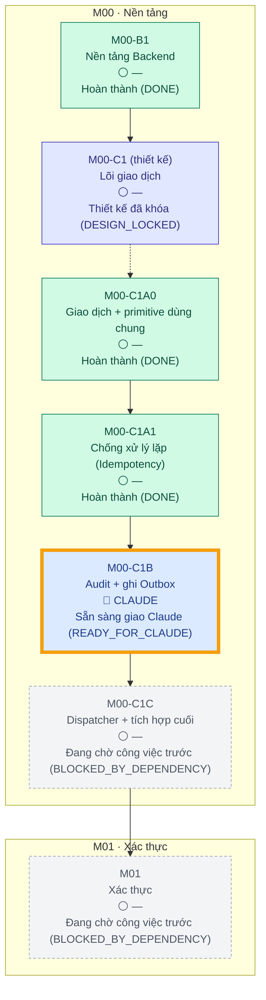

<!-- AUTO-GENERATED — DO NOT EDIT MANUALLY. Source: docs/progress/plan.yml + GitHub. Generator: scripts/generate-progress.mjs -->

# 11Ship — Tiến độ dự án

> **TỰ ĐỘNG TẠO — KHÔNG SỬA THỦ CÔNG**
>
> Kế hoạch nằm trong [`docs/progress/plan.yml`](progress/plan.yml); trạng thái được suy ra từ GitHub (PR đã merge, draft/open/closed, label, head SHA, required check và dependency). Không ai, kể cả người hay AI, có thể tự ghi một task thành HOÀN THÀNH. Xem [cách suy ra trạng thái](progress/README.md).
> Dữ liệu theo mã main `3d95309` (HEAD là commit progress-bot chỉ sửa tài liệu; CI được đọc từ commit mã này) · CI main: ✅ Đạt (`PASS`)

## 🎯 VIỆC ĐANG LÀM

| | |
|---|---|
| **Task** | **M00-C1B — Audit + ghi Outbox** |
| **Trạng thái** | 🟦 Sẵn sàng giao Claude (`READY_FOR_CLAUDE`) |
| **Người phụ trách** | 🔵 **CLAUDE** |
| **ChatGPT** | Chờ Claude triển khai trước khi kiểm tra |
| **Claude** | Sẵn sàng triển khai |
| **Chủ dự án** | Không cần thao tác |
| **Đang bị chặn bởi** | Không |
| **Điều kiện sang bước tiếp** | PR triển khai (agent:claude, type:implementation, module label) + required CI xanh |

## Tiến độ

Tính theo trọng số task trong kế hoạch (mỗi task lá = 1 nếu không ghi khác). Commit, số dòng code và PR đã hủy không được tính. Phần trăm được làm tròn xuống.

| Phạm vi | Hoàn thành / tổng |
|---|---|
| Milestone hiện tại — M00 Nền tảng | 3 / 5 (60%) |
| Toàn bộ — chỉ tính task đã lập kế hoạch (roadmap chưa chốt hết) | 3 / 6 (50%) |
| Module M01 Xác thực | 0 / 1 (0%) |

## Cây tiến độ

Mũi tên liền là dependency, mũi tên nét đứt là task cha → task con đầu tiên. Viền vàng đậm là việc đang làm.

## Chi tiết công việc

| Task | Trạng thái | Người phụ trách | PR | CI | Head | Dependency | Việc tiếp theo |
|---|---|---|---|---|---|---|---|
| M00-B1 · Nền tảng Backend | ✅ Hoàn thành (`DONE`) | — | [#2](https://github.com/trungtn87/11ship/pull/2) | ✅ Đạt (`PASS`) | `55c5d81` | — | — |
| **M00-C1** thiết kế · Lõi giao dịch | 🔒 Thiết kế đã khóa (`DESIGN_LOCKED`) | — | [#3](https://github.com/trungtn87/11ship/pull/3) | ✅ Đạt (`PASS`) | `de82b15` | B1 Hoàn thành (DONE) | Tiếp tục các task con |
| &nbsp;&nbsp;M00-C1A0 · Giao dịch + primitive dùng chung | ✅ Hoàn thành (`DONE`) | — | [#4](https://github.com/trungtn87/11ship/pull/4) | ✅ Đạt (`PASS`) | `688e796` | — | — |
| &nbsp;&nbsp;M00-C1A1 · Chống xử lý lặp (Idempotency) | ✅ Hoàn thành (`DONE`) | — | [#6](https://github.com/trungtn87/11ship/pull/6) | ✅ Đạt (`PASS`) | `44c0fa7` | C1A0 Hoàn thành (DONE) | — |
| &nbsp;&nbsp;M00-C1B · Audit + ghi Outbox | 🟦 Sẵn sàng giao Claude (`READY_FOR_CLAUDE`) | Claude | — | — | mã main `3d95309` | C1A1 Hoàn thành (DONE) | Claude triển khai |
| &nbsp;&nbsp;M00-C1C · Dispatcher + tích hợp cuối | ⛔ Đang chờ công việc trước (`BLOCKED_BY_DEPENDENCY`) | — | — | — | — | C1B Sẵn sàng giao Claude (READY_FOR_CLAUDE) | Chờ C1B |
| M01 · Xác thực | ⛔ Đang chờ công việc trước (`BLOCKED_BY_DEPENDENCY`) | — | — | — | — | C1C Đang chờ công việc trước (BLOCKED_BY_DEPENDENCY) | Chờ C1C |

## Danh sách Pull Request

Cách hệ thống xử lý từng PR. PR chỉ được tính qua metadata rõ ràng (label hoặc số PR được ghim trong kế hoạch), không bao giờ suy ra từ tiêu đề, nội dung hay tác giả.

| PR | Vòng đời | Task | Vai trò | CI trên head | Head | Cách tính |
|---|---|---|---|---|---|---|
| [#1](https://github.com/trungtn87/11ship/pull/1) Bước 5.1–5.2: kiểm tra repo, chốt nền và bàn giao M00-B1 | Đã merge (`MERGED`) | M00-B1 | thiết kế | — | `a07bbf7` | được tính |
| [#2](https://github.com/trungtn87/11ship/pull/2) feat(m00-b1): backend foundation — F01–F09 verified PASS | Đã merge (`MERGED`) | M00-B1 | triển khai | ✅ Đạt (`PASS`) | `55c5d81` | được tính |
| [#3](https://github.com/trungtn87/11ship/pull/3) docs(m00-c1): transactional core design | Đã merge (`MERGED`) | M00-C1 | thiết kế | ✅ Đạt (`PASS`) | `de82b15` | được tính |
| [#4](https://github.com/trungtn87/11ship/pull/4) M00-C1A0: transaction lifecycle and shared primitives | Đã merge (`MERGED`) | M00-C1A0 | triển khai | ✅ Đạt (`PASS`) | `688e796` | được tính |
| [#5](https://github.com/trungtn87/11ship/pull/5) feat(m00-c1a1): idempotency executor, replay and cleanup | 🚫 Đã hủy / bỏ qua (`CANCELLED / IGNORED`) | M00-C1A1 | triển khai | ✅ Đạt (`PASS`) | `e1c67b1` | 🚫 không tính (đã hủy) — PR triển khai do ChatGPT mở sai quy trình, đã đóng và không merge. Không được chấp nhận. |
| [#6](https://github.com/trungtn87/11ship/pull/6) M00-C1A1: Idempotency (draft) | Đã merge (`MERGED`) | M00-C1A1 | triển khai | ✅ Đạt (`PASS`) | `44c0fa7` | được tính |
| [#7](https://github.com/trungtn87/11ship/pull/7) docs(m03-m04): financial consistency, withdrawal reconcilia… | Bản nháp (`DRAFT`) | — | — | ✅ Đạt (`PASS`) | `645a59b` | ⚠️ không tính — thiếu metadata hợp lệ (thiếu module:&lt;task id&gt;, type:design¦implementation¦review-fix, agent:*); PR khôn… |
| [#8](https://github.com/trungtn87/11ship/pull/8) chore(progress): GitHub-derived project progress dashboard | Đã merge (`MERGED`) | — | hạ tầng | — | `1ce1e50` | ngoài kế hoạch — Ngoài kế hoạch (type:infra) |
| [#9](https://github.com/trungtn87/11ship/pull/9) M00-C1B: Audit + Outbox write primitives | Đã merge (`MERGED`) | — | — | — | `b418fd2` | ⚠️ không tính — thiếu metadata hợp lệ (thiếu module:&lt;task id&gt;, type:design¦implementation¦review-fix, agent:*); PR khôn… |
| [#10](https://github.com/trungtn87/11ship/pull/10) feat(outbox): M00-C1C outbox dispatcher + final | Đã merge (`MERGED`) | — | — | — | `172931b` | ⚠️ không tính — thiếu metadata hợp lệ (thiếu module:&lt;task id&gt;, type:design¦implementation¦review-fix, agent:*); PR khôn… |
| [#11](https://github.com/trungtn87/11ship/pull/11) docs(m01-a1): lock Auth Core implementation contract | Đã merge (`MERGED`) | — | — | — | `a17935f` | ⚠️ không tính — thiếu metadata hợp lệ (thiếu module:&lt;task id&gt;, type:design¦implementation¦review-fix, agent:*); PR khôn… |
| [#12](https://github.com/trungtn87/11ship/pull/12) feat(auth): M01-A1 Auth Core (READY CANDIDATE) | Đã merge (`MERGED`) | — | — | — | `ef3afd4` | ⚠️ không tính — thiếu metadata hợp lệ (thiếu module:&lt;task id&gt;, type:design¦implementation¦review-fix, agent:*); PR khôn… |
| [#13](https://github.com/trungtn87/11ship/pull/13) chore(progress): Việt hóa dashboard tiến độ | Đã merge (`MERGED`) | — | hạ tầng | — | `25a62e9` | ngoài kế hoạch — Ngoài kế hoạch (type:infra) |
| [#14](https://github.com/trungtn87/11ship/pull/14) docs(ui): add Figma workflow and frontend UI gate | Đang mở (`OPEN`) | — | hạ tầng | ✅ Đạt (`PASS`) | `0d16d7b` | ngoài kế hoạch — Ngoài kế hoạch (type:infra) |
| [#15](https://github.com/trungtn87/11ship/pull/15) docs(m01-a2): lock onboarding contract and task split | Đã merge (`MERGED`) | — | — | — | `c329808` | ⚠️ không tính — thiếu metadata hợp lệ (thiếu module:&lt;task id&gt;); PR không được tính. Trạng thái không bao giờ được suy r… |
| [#16](https://github.com/trungtn87/11ship/pull/16) feat(onboarding): M01-A2S shop onboarding | Đã merge (`MERGED`) | — | — | — | `620333f` | ⚠️ không tính — thiếu metadata hợp lệ (thiếu module:&lt;task id&gt;); PR không được tính. Trạng thái không bao giờ được suy r… |
| [#17](https://github.com/trungtn87/11ship/pull/17) feat(m01-a2d): DRIVER onboarding | Bản nháp (`DRAFT`) | — | — | ⏳ Đang chạy (`RUNNING`) | `ec60490` | ⚠️ không tính — thiếu metadata hợp lệ (thiếu module:&lt;task id&gt;, type:design¦implementation¦review-fix, agent:*); PR khôn… |

## ⚠️ Cần chú ý

- `UNCLASSIFIED_PR` PR #7: thiếu metadata hợp lệ (thiếu module:&lt;task id&gt;, type:design¦implementation¦review-fix, agent:*); PR không được tính. Trạng thái không bao giờ được suy ra từ tiêu đề, nội dung hoặc tác giả.
- `UNCLASSIFIED_PR` PR #17: thiếu metadata hợp lệ (thiếu module:&lt;task id&gt;, type:design¦implementation¦review-fix, agent:*); PR không được tính. Trạng thái không bao giờ được suy ra từ tiêu đề, nội dung hoặc tác giả.

## Quy trình

`KẾ HOẠCH → CHATGPT THIẾT KẾ → THIẾT KẾ ĐÃ KHÓA → SẴN SÀNG GIAO CLAUDE → CLAUDE CODE → CI → CHỜ CHATGPT KIỂM TRA → CHATGPT KIỂM TRA → SẴN SÀNG MERGE → ĐÃ MERGE / ĐÃ KHÓA → task tiếp theo`

ChatGPT thiết kế và kiểm tra, Claude triển khai và test, Chủ dự án chốt quyết định và merge. Không có gì được tự động merge.
