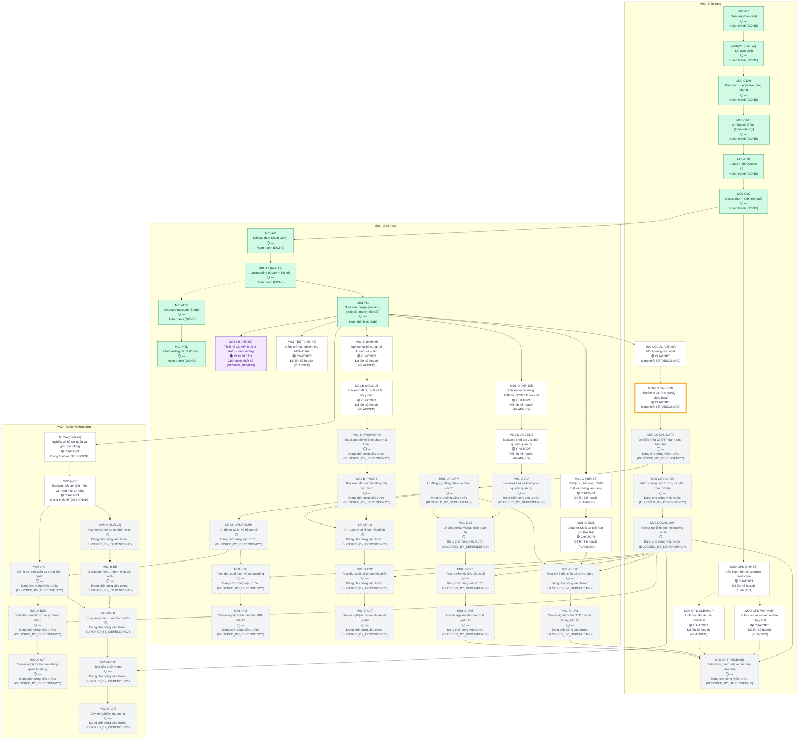

<!-- AUTO-GENERATED — DO NOT EDIT MANUALLY. Source: docs/progress/plan.yml + GitHub. Generator: scripts/generate-progress.mjs -->

# 11Ship — Tiến độ dự án

> **TỰ ĐỘNG TẠO — KHÔNG SỬA THỦ CÔNG**
>
> Kế hoạch nằm trong [`docs/progress/plan.yml`](progress/plan.yml); trạng thái được suy ra từ GitHub (PR đã merge, draft/open/closed, label, head SHA, required check và dependency). Không ai, kể cả người hay AI, có thể tự ghi một task thành HOÀN THÀNH. Xem [cách suy ra trạng thái](progress/README.md).
> Dữ liệu theo mã main `e844276` (HEAD là commit progress-bot chỉ sửa tài liệu; CI được đọc từ commit mã này) · CI main: ✅ Đạt (`PASS`)

## Các luồng song song và checklist

Nghiệp vụ → thiết kế backend/UI → triển khai → E2E → Owner nghiệm thu. Backend DONE không đồng nghĩa UI hoặc bản dùng thử đã đạt.

| Luồng | Thiết kế | Công việc / checklist |
|---|---|---|
| M00 — môi trường test local | 📐 Đang thiết kế (`DESIGNING`) · #20 | [Checklist](tasks/M00-delivery-checklist.md) · xem dependency từng gói bên dưới |
| M01 — UI và bản thử Auth/onboarding | 🧐 Chờ duyệt thiết kế (`DESIGN_REVIEW`) · #14 | [Checklist](tasks/M01-delivery-checklist.md) · xem dependency từng gói bên dưới |
| M02 — nghiệp vụ hồ sơ và lịch quán | 📐 Đang thiết kế (`DESIGNING`) · #18 | [Checklist](tasks/M02-delivery-checklist.md) · xem dependency từng gói bên dưới |

Thiết kế UI được làm trong khi chuẩn bị môi trường. Frame Figma và xác nhận Owner nằm trong evidence; CI không tự xác nhận hai bước này. [Quy trình đầy đủ](tasks/module-delivery-workflow.md).

## 🎯 VIỆC ĐANG LÀM

| | |
|---|---|
| **Task** | **M00-LOCAL-RUN — Backend và PostgreSQL chạy local** |
| **Trạng thái** | 📐 Đang thiết kế (`DESIGNING`) |
| **Người phụ trách** | 🟣 **CHATGPT** |
| **ChatGPT** | Đang thiết kế |
| **Claude** | Chưa bắt đầu (chưa được mở khóa) |
| **Chủ dự án** | Không cần thao tác |
| **Đang bị chặn bởi** | Không |
| **Điều kiện sang bước tiếp** | PR thiết kế sẵn sàng review |
| **PR đang hoạt động** | PR #20 |

## Tiến độ

Tính theo trọng số task trong kế hoạch (mỗi task lá = 1 nếu không ghi khác). Commit, số dòng code và PR đã hủy không được tính. Phần trăm được làm tròn xuống.

| Phạm vi | Hoàn thành / tổng |
|---|---|
| Milestone hiện tại — M00 Nền tảng | 5 / 12 (41%) |
| Toàn bộ — chỉ tính task đã lập kế hoạch (roadmap chưa chốt hết) | 9 / 42 (21%) |
| Module M01 Xác thực | 4 / 22 (18%) |
| Module M02 Quán và thực đơn | 0 / 8 (0%) |

## Cây tiến độ

Mũi tên liền là dependency, mũi tên nét đứt là task cha → task con đầu tiên. Viền vàng đậm là việc đang làm.

## Chi tiết công việc

| Task | Trạng thái | Người phụ trách | PR | CI | Head | Dependency | Việc tiếp theo |
|---|---|---|---|---|---|---|---|
| M00-B1 · Nền tảng Backend | ✅ Hoàn thành (`DONE`) | — | [#2](https://github.com/trungtn87/11ship/pull/2) | ✅ Đạt (`PASS`) | `55c5d81` | — | — |
| **M00-C1** thiết kế · Lõi giao dịch | ✅ Hoàn thành (`DONE`) | — | [#3](https://github.com/trungtn87/11ship/pull/3) | ✅ Đạt (`PASS`) | `de82b15` | B1 Hoàn thành (DONE) | — |
| &nbsp;&nbsp;M00-C1A0 · Giao dịch + primitive dùng chung | ✅ Hoàn thành (`DONE`) | — | [#4](https://github.com/trungtn87/11ship/pull/4) | ✅ Đạt (`PASS`) | `688e796` | — | — |
| &nbsp;&nbsp;M00-C1A1 · Chống xử lý lặp (Idempotency) | ✅ Hoàn thành (`DONE`) | — | [#6](https://github.com/trungtn87/11ship/pull/6) | ✅ Đạt (`PASS`) | `44c0fa7` | C1A0 Hoàn thành (DONE) | — |
| &nbsp;&nbsp;M00-C1B · Audit + ghi Outbox | ✅ Hoàn thành (`DONE`) | — | [#9](https://github.com/trungtn87/11ship/pull/9) | ✅ Đạt (`PASS`) | `b418fd2` | C1A1 Hoàn thành (DONE) | — |
| &nbsp;&nbsp;M00-C1C · Dispatcher + tích hợp cuối | ✅ Hoàn thành (`DONE`) | — | [#10](https://github.com/trungtn87/11ship/pull/10) | ✅ Đạt (`PASS`) | `172931b` | C1B Hoàn thành (DONE) | — |
| **M00-LOCAL** thiết kế · Môi trường test local | 📐 Đang thiết kế (`DESIGNING`) | ChatGPT | [#20](https://github.com/trungtn87/11ship/pull/20) | ✅ Đạt (`PASS`) | `a15278e` | R1 Hoàn thành (DONE) | ChatGPT hoàn tất PR thiết kế #20 |
| &nbsp;&nbsp;M00-LOCAL-RUN · Backend và PostgreSQL chạy local | 📐 Đang thiết kế (`DESIGNING`) | ChatGPT | [#20](https://github.com/trungtn87/11ship/pull/20) | ✅ Đạt (`PASS`) | `a15278e` | — | ChatGPT hoàn tất PR thiết kế #20 |
| &nbsp;&nbsp;M00-LOCAL-DATA · Dữ liệu mẫu và OTP dành cho bản thử | ⛔ Đang chờ công việc trước (`BLOCKED_BY_DEPENDENCY`) | — | — | — | — | LOCAL-RUN Đang thiết kế (DESIGNING) | Chờ LOCAL-RUN |
| &nbsp;&nbsp;M00-LOCAL-QA · Kiểm chứng môi trường và khôi phục dữ liệu | ⛔ Đang chờ công việc trước (`BLOCKED_BY_DEPENDENCY`) | — | — | — | — | LOCAL-DATA Đang chờ công việc trước (BLOCKED_BY_DEPENDENCY) | Chờ LOCAL-DATA |
| &nbsp;&nbsp;M00-LOCAL-UAT · Owner nghiệm thu môi trường local | ⛔ Đang chờ công việc trước (`BLOCKED_BY_DEPENDENCY`) | — | — | — | — | LOCAL-QA Đang chờ công việc trước (BLOCKED_BY_DEPENDENCY) | Chờ LOCAL-QA |
| M01-A1 · Lõi xác thực (Auth Core) | ✅ Hoàn thành (`DONE`) | — | [#12](https://github.com/trungtn87/11ship/pull/12) | ✅ Đạt (`PASS`) | `ef3afd4` | C1C Hoàn thành (DONE) | — |
| **M01-A2** thiết kế · Onboarding (Quán + Tài xế) | ✅ Hoàn thành (`DONE`) | — | [#15](https://github.com/trungtn87/11ship/pull/15) | ✅ Đạt (`PASS`) | `c329808` | A1 Hoàn thành (DONE) | — |
| &nbsp;&nbsp;M01-A2S · Onboarding quán (Shop) | ✅ Hoàn thành (`DONE`) | — | [#16](https://github.com/trungtn87/11ship/pull/16) | ✅ Đạt (`PASS`) | `620333f` | — | — |
| &nbsp;&nbsp;M01-A2D · Onboarding tài xế (Driver) | ✅ Hoàn thành (`DONE`) | — | [#17](https://github.com/trungtn87/11ship/pull/17) | ✅ Đạt (`PASS`) | `c37082a` | A2S Hoàn thành (DONE) | — |
| M01-R1 · Sửa sau merge (session, rollback, router, tiến độ) | ✅ Hoàn thành (`DONE`) | — | [#19](https://github.com/trungtn87/11ship/pull/19) | ✅ Đạt (`PASS`) | `cd0e6de` | A2 Hoàn thành (DONE) | — |
| **M01-UI** thiết kế · Thiết kế và triển khai UI Auth + onboarding | 🧐 Chờ duyệt thiết kế (`DESIGN_REVIEW`) | Chủ dự án | [#14](https://github.com/trungtn87/11ship/pull/14) | ✅ Đạt (`PASS`) | `0d16d7b` | R1 Hoàn thành (DONE) | Chủ dự án duyệt và khóa PR thiết kế #14 |
| &nbsp;&nbsp;M01-UI-AUTH · UI đăng ký, đăng nhập và chọn vai trò | ⛔ Đang chờ công việc trước (`BLOCKED_BY_DEPENDENCY`) | — | — | — | — | LOCAL-DATA Đang chờ công việc trước (BLOCKED_BY_DEPENDENCY) | Chờ LOCAL-DATA |
| &nbsp;&nbsp;M01-UI-ONBOARD · UI hồ sơ quán và hồ sơ xế | ⛔ Đang chờ công việc trước (`BLOCKED_BY_DEPENDENCY`) | — | — | — | — | UI-AUTH Đang chờ công việc trước (BLOCKED_BY_DEPENDENCY) | Chờ UI-AUTH |
| **M01-TEST** thiết kế · Kiểm thử và nghiệm thu M01-A1/A2 | 📝 Đã lên kế hoạch (`PLANNED`) | ChatGPT | — | — | — | R1 Hoàn thành (DONE) | ChatGPT thiết kế |
| &nbsp;&nbsp;M01-E2E · Test đầu cuối Auth và onboarding | ⛔ Đang chờ công việc trước (`BLOCKED_BY_DEPENDENCY`) | — | — | — | — | UI-ONBOARD Đang chờ công việc trước (BLOCKED_BY_DEPENDENCY), LOCAL-UAT Đang chờ công việc trước (BLOCKED_BY_DEPENDENCY) | Chờ UI-ONBOARD, LOCAL-UAT |
| &nbsp;&nbsp;M01-UAT · Owner nghiệm thu bản thử M01-A1/A2 | ⛔ Đang chờ công việc trước (`BLOCKED_BY_DEPENDENCY`) | — | — | — | — | E2E Đang chờ công việc trước (BLOCKED_BY_DEPENDENCY) | Chờ E2E |
| **M01-B** thiết kế · Nghiệp vụ bổ sung: tài khoản và phiên | 📝 Đã lên kế hoạch (`PLANNED`) | ChatGPT | — | — | — | R1 Hoàn thành (DONE) | ChatGPT thiết kế |
| &nbsp;&nbsp;M01-B-LOGOUT · Backend đăng xuất và thu hồi phiên | 📝 Đã lên kế hoạch (`PLANNED`) | ChatGPT | — | — | — | — | ChatGPT thiết kế |
| &nbsp;&nbsp;M01-B-PASSWORD · Backend đổi và khôi phục mật khẩu | ⛔ Đang chờ công việc trước (`BLOCKED_BY_DEPENDENCY`) | — | — | — | — | B-LOGOUT Đã lên kế hoạch (PLANNED) | Chờ B-LOGOUT |
| &nbsp;&nbsp;M01-B-PHONE · Backend đổi số điện thoại đã xác minh | ⛔ Đang chờ công việc trước (`BLOCKED_BY_DEPENDENCY`) | — | — | — | — | B-PASSWORD Đang chờ công việc trước (BLOCKED_BY_DEPENDENCY) | Chờ B-PASSWORD |
| &nbsp;&nbsp;M01-B-UI · UI quản lý tài khoản và phiên | ⛔ Đang chờ công việc trước (`BLOCKED_BY_DEPENDENCY`) | — | — | — | — | B-PHONE Đang chờ công việc trước (BLOCKED_BY_DEPENDENCY), UI-AUTH Đang chờ công việc trước (BLOCKED_BY_DEPENDENCY) | Chờ B-PHONE, UI-AUTH |
| &nbsp;&nbsp;M01-B-E2E · Test đầu cuối tài khoản và phiên | ⛔ Đang chờ công việc trước (`BLOCKED_BY_DEPENDENCY`) | — | — | — | — | B-UI Đang chờ công việc trước (BLOCKED_BY_DEPENDENCY), LOCAL-UAT Đang chờ công việc trước (BLOCKED_BY_DEPENDENCY) | Chờ B-UI, LOCAL-UAT |
| &nbsp;&nbsp;M01-B-UAT · Owner nghiệm thu tài khoản và phiên | ⛔ Đang chờ công việc trước (`BLOCKED_BY_DEPENDENCY`) | — | — | — | — | B-E2E Đang chờ công việc trước (BLOCKED_BY_DEPENDENCY) | Chờ B-E2E |
| **M01-C** thiết kế · Nghiệp vụ bổ sung: SMS thật và chống lạm dụng | 📝 Đã lên kế hoạch (`PLANNED`) | ChatGPT | — | — | — | R1 Hoàn thành (DONE) | ChatGPT thiết kế |
| &nbsp;&nbsp;M01-C-SMS · Adapter SMS và giới hạn gửi/thử thật | 📝 Đã lên kế hoạch (`PLANNED`) | ChatGPT | — | — | — | — | ChatGPT thiết kế |
| &nbsp;&nbsp;M01-C-E2E · Test SMS thật trên số được phép | ⛔ Đang chờ công việc trước (`BLOCKED_BY_DEPENDENCY`) | — | — | — | — | C-SMS Đã lên kế hoạch (PLANNED), UI-AUTH Đang chờ công việc trước (BLOCKED_BY_DEPENDENCY), LOCAL-UAT Đang chờ công việc trước (BLOCKED_BY_DEPENDENCY) | Chờ C-SMS, UI-AUTH, LOCAL-UAT |
| &nbsp;&nbsp;M01-C-UAT · Owner nghiệm thu OTP thật và thông báo lỗi | ⛔ Đang chờ công việc trước (`BLOCKED_BY_DEPENDENCY`) | — | — | — | — | C-E2E Đang chờ công việc trước (BLOCKED_BY_DEPENDENCY) | Chờ C-E2E |
| **M01-D** thiết kế · Nghiệp vụ bổ sung: ADMIN, SYSTEM và 2FA | 📝 Đã lên kế hoạch (`PLANNED`) | ChatGPT | — | — | — | R1 Hoàn thành (DONE) | ChatGPT thiết kế |
| &nbsp;&nbsp;M01-D-ACCESS · Backend khởi tạo và phân quyền quản trị | 📝 Đã lên kế hoạch (`PLANNED`) | ChatGPT | — | — | — | — | ChatGPT thiết kế |
| &nbsp;&nbsp;M01-D-2FA · Backend 2FA và khôi phục quyền quản trị | ⛔ Đang chờ công việc trước (`BLOCKED_BY_DEPENDENCY`) | — | — | — | — | D-ACCESS Đã lên kế hoạch (PLANNED) | Chờ D-ACCESS |
| &nbsp;&nbsp;M01-D-UI · UI đăng nhập và bảo mật quản trị | ⛔ Đang chờ công việc trước (`BLOCKED_BY_DEPENDENCY`) | — | — | — | — | D-2FA Đang chờ công việc trước (BLOCKED_BY_DEPENDENCY), UI-AUTH Đang chờ công việc trước (BLOCKED_BY_DEPENDENCY) | Chờ D-2FA, UI-AUTH |
| &nbsp;&nbsp;M01-D-E2E · Test quyền và 2FA đầu cuối | ⛔ Đang chờ công việc trước (`BLOCKED_BY_DEPENDENCY`) | — | — | — | — | D-UI Đang chờ công việc trước (BLOCKED_BY_DEPENDENCY), LOCAL-UAT Đang chờ công việc trước (BLOCKED_BY_DEPENDENCY) | Chờ D-UI, LOCAL-UAT |
| &nbsp;&nbsp;M01-D-UAT · Owner nghiệm thu bảo mật quản trị | ⛔ Đang chờ công việc trước (`BLOCKED_BY_DEPENDENCY`) | — | — | — | — | D-E2E Đang chờ công việc trước (BLOCKED_BY_DEPENDENCY) | Chờ D-E2E |
| **M02-A** thiết kế · Nghiệp vụ hồ sơ quán và giờ hoạt động | 📐 Đang thiết kế (`DESIGNING`) | ChatGPT | [#18](https://github.com/trungtn87/11ship/pull/18) | ✅ Đạt (`PASS`) | `ebb0f3a` | R1 Hoàn thành (DONE) | ChatGPT hoàn tất PR thiết kế #18 |
| &nbsp;&nbsp;M02-A-BE · Backend hồ sơ, lịch tuần và trạng thái tự động | 📐 Đang thiết kế (`DESIGNING`) | ChatGPT | [#18](https://github.com/trungtn87/11ship/pull/18) | ✅ Đạt (`PASS`) | `ebb0f3a` | — | ChatGPT hoàn tất PR thiết kế #18 |
| &nbsp;&nbsp;M02-A-UI · UI hồ sơ, lịch tuần và trạng thái quán | ⛔ Đang chờ công việc trước (`BLOCKED_BY_DEPENDENCY`) | — | — | — | — | A-BE Đang thiết kế (DESIGNING), UI-ONBOARD Đang chờ công việc trước (BLOCKED_BY_DEPENDENCY) | Chờ A-BE, UI-ONBOARD |
| &nbsp;&nbsp;M02-A-E2E · Test đầu cuối hồ sơ và lịch hoạt động | ⛔ Đang chờ công việc trước (`BLOCKED_BY_DEPENDENCY`) | — | — | — | — | A-UI Đang chờ công việc trước (BLOCKED_BY_DEPENDENCY), LOCAL-UAT Đang chờ công việc trước (BLOCKED_BY_DEPENDENCY) | Chờ A-UI, LOCAL-UAT |
| &nbsp;&nbsp;M02-A-UAT · Owner nghiệm thu hoạt động quán tự động | ⛔ Đang chờ công việc trước (`BLOCKED_BY_DEPENDENCY`) | — | — | — | — | A-E2E Đang chờ công việc trước (BLOCKED_BY_DEPENDENCY) | Chờ A-E2E |
| **M02-B** thiết kế · Nghiệp vụ menu và nhóm món | ⛔ Đang chờ công việc trước (`BLOCKED_BY_DEPENDENCY`) | — | — | — | — | A-BE Đang thiết kế (DESIGNING) | Chờ A-BE |
| &nbsp;&nbsp;M02-B-BE · Backend menu, nhóm món và ảnh | ⛔ Đang chờ công việc trước (`BLOCKED_BY_DEPENDENCY`) | — | — | — | — | — | Chờ A-BE |
| &nbsp;&nbsp;M02-B-UI · UI quản lý menu và nhóm món | ⛔ Đang chờ công việc trước (`BLOCKED_BY_DEPENDENCY`) | — | — | — | — | B-BE Đang chờ công việc trước (BLOCKED_BY_DEPENDENCY), A-UI Đang chờ công việc trước (BLOCKED_BY_DEPENDENCY) | Chờ B-BE, A-UI, A-BE |
| &nbsp;&nbsp;M02-B-E2E · Test đầu cuối menu | ⛔ Đang chờ công việc trước (`BLOCKED_BY_DEPENDENCY`) | — | — | — | — | B-UI Đang chờ công việc trước (BLOCKED_BY_DEPENDENCY), LOCAL-UAT Đang chờ công việc trước (BLOCKED_BY_DEPENDENCY) | Chờ B-UI, LOCAL-UAT, A-BE |
| &nbsp;&nbsp;M02-B-UAT · Owner nghiệm thu menu | ⛔ Đang chờ công việc trước (`BLOCKED_BY_DEPENDENCY`) | — | — | — | — | B-E2E Đang chờ công việc trước (BLOCKED_BY_DEPENDENCY) | Chờ B-E2E, A-BE |
| **M00-OPS** thiết kế · Vận hành nền tảng trước production | 📝 Đã lên kế hoạch (`PLANNED`) | ChatGPT | — | — | — | C1C Hoàn thành (DONE) | ChatGPT thiết kế |
| &nbsp;&nbsp;M00-OPS-WORKER · Publisher và worker outbox chạy thật | 📝 Đã lên kế hoạch (`PLANNED`) | ChatGPT | — | — | — | — | ChatGPT thiết kế |
| &nbsp;&nbsp;M00-OPS-CLEANUP · Lịch dọn dữ liệu và retention | 📝 Đã lên kế hoạch (`PLANNED`) | ChatGPT | — | — | — | — | ChatGPT thiết kế |
| &nbsp;&nbsp;M00-OPS-RELEASE · Triển khai, giám sát và diễn tập phục hồi | ⛔ Đang chờ công việc trước (`BLOCKED_BY_DEPENDENCY`) | — | — | — | — | LOCAL-UAT Đang chờ công việc trước (BLOCKED_BY_DEPENDENCY), OPS-WORKER Đã lên kế hoạch (PLANNED), OPS-CLEANUP Đã lên kế hoạch (PLANNED), C-UAT Đang chờ công việc trước (BLOCKED_BY_DEPENDENCY), D-UAT Đang chờ công việc trước (BLOCKED_BY_DEPENDENCY) | Chờ LOCAL-UAT, OPS-WORKER, OPS-CLEANUP, C-UAT, D-UAT |

## Danh sách Pull Request

Cách hệ thống xử lý từng PR. PR chỉ được tính qua metadata rõ ràng (label hoặc số PR được ghim trong kế hoạch), không bao giờ suy ra từ tiêu đề, nội dung hay tác giả.

| PR | Vòng đời | Task | Vai trò | CI trên head | Head | Cách tính |
|---|---|---|---|---|---|---|
| [#1](https://github.com/trungtn87/11ship/pull/1) Bước 5.1–5.2: kiểm tra repo, chốt nền và bàn giao M00-B1 | Đã merge (`MERGED`) | M00-B1 | thiết kế | — | `a07bbf7` | được tính |
| [#2](https://github.com/trungtn87/11ship/pull/2) feat(m00-b1): backend foundation — F01–F09 verified PASS | Đã merge (`MERGED`) | M00-B1 | triển khai | ✅ Đạt (`PASS`) | `55c5d81` | được tính |
| [#3](https://github.com/trungtn87/11ship/pull/3) docs(m00-c1): transactional core design | Đã merge (`MERGED`) | M00-C1 | thiết kế | ✅ Đạt (`PASS`) | `de82b15` | được tính |
| [#4](https://github.com/trungtn87/11ship/pull/4) M00-C1A0: transaction lifecycle and shared primitives | Đã merge (`MERGED`) | M00-C1A0 | triển khai | ✅ Đạt (`PASS`) | `688e796` | được tính |
| [#5](https://github.com/trungtn87/11ship/pull/5) feat(m00-c1a1): idempotency executor, replay and cleanup | 🚫 Đã hủy / bỏ qua (`CANCELLED / IGNORED`) | M00-C1A1 | triển khai | ✅ Đạt (`PASS`) | `e1c67b1` | 🚫 không tính (đã hủy) — PR triển khai do ChatGPT mở sai quy trình, đã đóng và không merge. Không được chấp nhận. |
| [#6](https://github.com/trungtn87/11ship/pull/6) M00-C1A1: Idempotency (draft) | Đã merge (`MERGED`) | M00-C1A1 | triển khai | ✅ Đạt (`PASS`) | `44c0fa7` | được tính |
| [#7](https://github.com/trungtn87/11ship/pull/7) docs(m03-m04): financial consistency, withdrawal reconcilia… | Bản nháp (`DRAFT`) | — | — | ✅ Đạt (`PASS`) | `645a59b` | ⚠️ không tính — thiếu metadata hợp lệ (thiếu module:&lt;task id&gt;, type:design¦implementation¦review-fix, agent:*); PR khôn… |
| [#8](https://github.com/trungtn87/11ship/pull/8) chore(progress): GitHub-derived project progress dashboard | Đã merge (`MERGED`) | — | hạ tầng | — | `1ce1e50` | ngoài kế hoạch — Ngoài kế hoạch (type:infra) |
| [#9](https://github.com/trungtn87/11ship/pull/9) M00-C1B: Audit + Outbox write primitives | Đã merge (`MERGED`) | M00-C1B | triển khai | ✅ Đạt (`PASS`) | `b418fd2` | được tính |
| [#10](https://github.com/trungtn87/11ship/pull/10) feat(outbox): M00-C1C outbox dispatcher + final | Đã merge (`MERGED`) | M00-C1C | triển khai | ✅ Đạt (`PASS`) | `172931b` | được tính |
| [#11](https://github.com/trungtn87/11ship/pull/11) docs(m01-a1): lock Auth Core implementation contract | Đã merge (`MERGED`) | M01-A1 | thiết kế | ✅ Đạt (`PASS`) | `a17935f` | được tính |
| [#12](https://github.com/trungtn87/11ship/pull/12) feat(auth): M01-A1 Auth Core (READY CANDIDATE) | Đã merge (`MERGED`) | M01-A1 | triển khai | ✅ Đạt (`PASS`) | `ef3afd4` | được tính |
| [#13](https://github.com/trungtn87/11ship/pull/13) chore(progress): Việt hóa dashboard tiến độ | Đã merge (`MERGED`) | — | hạ tầng | — | `25a62e9` | ngoài kế hoạch — Ngoài kế hoạch (type:infra) |
| [#14](https://github.com/trungtn87/11ship/pull/14) docs(ui): add Figma workflow and frontend UI gate | Đang mở (`OPEN`) | M01-UI | thiết kế | ✅ Đạt (`PASS`) | `0d16d7b` | được tính |
| [#15](https://github.com/trungtn87/11ship/pull/15) docs(m01-a2): lock onboarding contract and task split | Đã merge (`MERGED`) | M01-A2 | thiết kế | ✅ Đạt (`PASS`) | `c329808` | được tính |
| [#16](https://github.com/trungtn87/11ship/pull/16) feat(onboarding): M01-A2S shop onboarding | Đã merge (`MERGED`) | M01-A2S | triển khai | ✅ Đạt (`PASS`) | `620333f` | được tính |
| [#17](https://github.com/trungtn87/11ship/pull/17) feat(m01-a2d): DRIVER onboarding (no Driver service area) | Đã merge (`MERGED`) | M01-A2D | triển khai | ✅ Đạt (`PASS`) | `c37082a` | được tính |
| [#18](https://github.com/trungtn87/11ship/pull/18) docs(m02-a): hồ sơ quán và tự động hoạt động theo giờ | Bản nháp (`DRAFT`) | M02-A | thiết kế | ✅ Đạt (`PASS`) | `ebb0f3a` | được tính |
| [#19](https://github.com/trungtn87/11ship/pull/19) docs(m00-m01): session authorization, bounded rollback, rou… | Đã merge (`MERGED`) | M01-R1 | thiết kế + triển khai | ✅ Đạt (`PASS`) | `cd0e6de` | được tính |
| [#20](https://github.com/trungtn87/11ship/pull/20) docs(plan): thiết kế M02 song song bản thử UI M01 | Bản nháp (`DRAFT`) | M00-LOCAL | thiết kế | ✅ Đạt (`PASS`) | `a15278e` | được tính |

## ⚠️ Cần chú ý

- `UNCLASSIFIED_PR` PR #7: thiếu metadata hợp lệ (thiếu module:&lt;task id&gt;, type:design¦implementation¦review-fix, agent:*); PR không được tính. Trạng thái không bao giờ được suy ra từ tiêu đề, nội dung hoặc tác giả.

## Quy trình

`KẾ HOẠCH → CHATGPT THIẾT KẾ → THIẾT KẾ ĐÃ KHÓA → SẴN SÀNG GIAO CLAUDE → CLAUDE CODE → CI → CHỜ CHATGPT KIỂM TRA → CHATGPT KIỂM TRA → SẴN SÀNG MERGE → ĐÃ MERGE / ĐÃ KHÓA → task tiếp theo`

ChatGPT thiết kế và kiểm tra, Claude triển khai và test, Chủ dự án chốt quyết định và merge. Không có gì được tự động merge.
