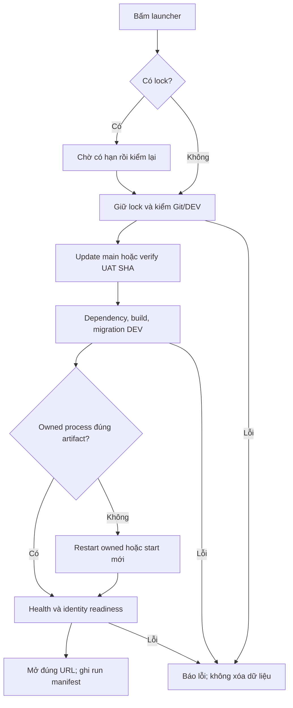

# M00 - Ba launcher và môi trường thử

Version 2.0.0; **DESIGN_CANDIDATE / WAITING_UI_REVIEW**; nguồn [audit](00-audit.md), #39/#40/#46 và workflow. Mục tiêu: Owner double-click ba shortcut và mở đúng app đang chạy với chung backend/DB DEV. Không cần gõ lệnh mỗi lần cập nhật. Auto Git update, auto mở trình duyệt, giữ backend khi đóng trình duyệt: **CHỐT**.

## 1. Kiểm kê và ranh giới

| Đã có | Thiếu | Cần sửa | Bổ sung mới |
|---|---|---|---|
| Launcher nền, DEV/TEST, health, guard Git, build backend | Hai shell, Admin trên main/integration approved, ba shortcut đủ chạy | Findings L01-L08; stale SHA; chứng chỉ | Single lock, frontend ownership, build manifest, chẩn đoán, run evidence |

M00 dùng Admin login/TOTP **đã code ở M01** làm dependency smoke; không phát triển invitations, reset hoặc full permission trong M00. Không tạo đơn, ví, menu, bank, GPS nghiệp vụ. Food/Ship chạy guest shell với navigation thật; màn Auth có bố cục đã thiết kế nhưng chỉ nối trong M01. Không nhận UI giả đăng nhập là PASS.

## 2. Chọn kỹ thuật và tổ chức file

**BỔ SUNG**: responsive HTML/CSS/TypeScript, build nhỏ tương tự Admin hiện có; không thay Admin bằng React/không thay backend stack. Hai web entry PC là runtime thử của app Android, không phát sinh sản phẩm Web thứ hai. Native runtime/package do M00-NATIVE/M01 phone slice chốt sau; PR #31 Java diagnostics chỉ tái sử dụng phần hợp lệ sau review.

| File/thư mục dự kiến | Trách nhiệm |
|---|---|
| `tools/local/11Ship-{Admin,Food,Ship}.cmd` | Wrapper gọi orchestrator, giữ exit code, cwd độc lập |
| `tools/local/11ship-app-launch.ps1` | Shared lock, update/build/start/readiness/open app |
| `tools/local/11ship-launcher.ps1` | Giữ DEV/TEST guard; sửa fingerprint/restart/status có tests |
| `apps/food-web/{package.json,public,src,tsconfig.json}` | Shell 11Food PC; guest/account/login states |
| `apps/ship-web/{package.json,public,src,tsconfig.json}` | Shell DRIVER PC; guest/home/account states |
| `apps/client-shared/src/{health,errors,environment,navigation}.ts` | Transport health, no-store, trạng thái; không đặt logic quyền ở client |
| `apps/client-shared/public/brand/` | Asset đã duyệt, font local/OFL; không tạo lại logo |
| `scripts/{food-web,ship-web}-build.mjs` | Build target và build manifest |
| `scripts/{food-web,ship-web}-dev.mjs` | Loopback HTTPS server + proxy allowlist health; Auth mở ở M01 |
| `tests/local-launcher/`, `tests/client-shell/` | Behavior/ports/cwd/version/health/browser |
| `ops/runbooks/three-app-local-test.md` | Setup một lần, dùng ba nút, recovery, UAT |

Không đưa thư mục `.11ship-local`/secret/cert key/log thô vào git. Registry generated/version metadata không phải bảng DB. Không thiết kế migration/schema nghiệp vụ mới trong M00-3APP. Migration Admin Auth đã review chỉ được kế thừa như dependency M01 của integration candidate, theo compatibility/DEV guard; chưa đủ dependency thì BLOCKED slice Admin.

## 3. URL, môi trường và update

| Thành phần | Mặc định PC | Ghi chú |
|---|---|---|
| Backend | `http://127.0.0.1:3000` | Loopback; proxy của frontend; không mở DB/API công khai |
| Admin | `https://localhost:8443` | Giữ cookies __Host và exact Origin hiện có |
| Food | `https://localhost:8444` | App title 11Food; max phone canvas 430px |
| Ship | `https://localhost:8445` | App title 11Ship; max phone canvas 430px |
| DEV | `ship11_dev@127.0.0.1:5432/ship11_dev` | Owner test; dữ liệu bền sau stop/update |
| TEST | `ship11_test@127.0.0.1:5433/ship11_test` | Chỉ suite phá dữ liệu có guard |

Thông số cổng là default cấu hình nội bộ; có conflict thì báo rõ, không tự mở app nhầm cổng. Node 24.21.0/npm11 theo guard launcher hiện có; Claude đối chiếu pin/CI trước build, không tự downgrade.

Chỉ một checkout vận hành Owner (ví dụ D:\11ship). Chế độ main tự update **main tracking origin/main**, fast-forward only. Owner test PR trước merge dùng checkout/nhánh UAT tách, cấu hình pin full SHA; không tự chuyển nhánh hay auto-pull thay head đang nghiệm thu. Việc pin UAT không miễn clean-tree/dependency/migration guard. Di chuyển shortcut khi đổi thư mục phải qua Install Shortcut, không hard-code đường dẫn trong code.

Git fail/dirty/diverged/collision thì dừng trước build; thông báo nguyên nhân, mã lỗi và nút mở hướng dẫn. Không auto reset/stash/checkout hoặc chạy stale source. Có thể tiếp tục **bản hiện tại đã verified** khi Owner chủ động chọn từ Status/runbook; không tự làm và không ghi update thành công. Lần đầu setup chọn nguồn update; những lần sau chỉ double-click.

## 4. Startup và ownership

- Lock chung giữ cả Update/dependency/build/migration/process-state, chờ tối đa 120s với trạng thái hiện tại; hết hạn `LAUNCH_LOCK_TIMEOUT`. Worker giữ lock có PID/start time; reclaim stale lock sau kiểm chứng process đã chết, không chỉ tuổi file.
- Wrapper phải lấy `$PSScriptRoot` đúng; npm/build/start luôn cwd=repo. Sau Git đổi script, re-exec orchestrator một lần với updated SHA/cycle flag; tránh vòng pull vô hạn.
- Build artifact có `source_sha`, `build_fingerprint`, `built_at`, `app_id`, `design_version`. Runtime process đọc fingerprint khi start. Source SHA hoặc fingerprint khác thì rebuild/restart owned process. Chưa tối ưu bỏ restart khi chỉ đổi tài liệu; ưu tiên minh bạch phiên bản. Không gán SHA mới cho process cũ.
- State process: PID, start UTC, repo absolute path, executable/script identity, loopback host/port, source SHA và fingerprint. Ghi temp+atomic rename. PID reuse/corrupt state phải báo chưa xác minh.
- Shared backend running đúng source SHA và fingerprint thì reuse. Sai source SHA hoặc fingerprint thì chỉ restart process owned sau safe local gate; dừng process cũ trước apply migration nếu nó có thể chạm DB đang đổi. Tuyệt đối không kill theo mỗi PID/cổng hoặc `taskkill /IM node.exe`.
- Frontend foreign port/identity mismatch phải `PORT_IN_USE`, không kill và không coi HTTP200 là app ready. Kiểm manifest + đúng title/app id + owned process; backend liveness/readiness đều đúng body.
- Build fail không ghi fingerprint mới/ready. Migration fail không mở browser; không down/reset/ghi history giả. Pending migration vẫn dùng xác nhận DEV hiện có với đích và danh sách rõ; giữ quyết định này, không bypass bằng `-Yes` mặc định.
- Backend và ba front ends sống khi browser đóng. Stop cũ mở rộng dừng đủ owned frontends/backend, giữ volume DEV. Test không stop app Owner đang dùng/không đọc-write dữ liệu DEV.

## 5. TLS và tích hợp Admin

Reuse #34/#35, đối chiếu #42 (đã mang cả login/UI/fixture). Không cherry-pick toàn #42 lên main như lối tắt: branch này có staging config/fixture và không chứa tất cả head mới của invitations. Integrate chọn commits tương ứng, refresh diff/head, test lại liên thông. Không kéo #41/#45 vào M00 chỉ vì chúng là Auth.

Local Admin needs allowed origin `https://localhost:8443`, cookie Secure/HttpOnly/SameSite, x-csrf-token. Reuse `admin-web:cert`/mkcert procedure: setup một lần, leaf SAN localhost/127.0.0.1, key giữ riêng. Không auto trust CA hệ thống/không tắt TLS verification toàn process. Owner consent cho certificate trust ở setup nếu cần; các lượt launch sau không hỏi lặp. Readiness xác minh chain hoặc pin leaf fingerprint từ local file, không arbitrary `-k`. Browser chỉ PASS khi không có cảnh báo chứng chỉ ở acceptance.

Admin bootstrap SYSTEM/init-limit-config local do công cụ hiện có; stdin, không lưu mật khẩu trong docs/log/command line. Không tự tạo SYSTEM mỗi lần launch. Limit config phải initialized để login/TOTP thật. Build Admin rồi start same-origin proxy hiện có; extend proxy route chỉ ở task API tương ứng, không wildcard `/v1/*` vào Admin.

## 6. UI/UX M00

- Phone canvas 390x844 reference; 360px không overflow; PC page nền trung tính, canvas giữa và diagnostics panel thu gọn riêng. Desktop Admin giữ responsive app có sẵn.
- Food: header logo, tài khoản, địa chỉ guest; hero brand; Trang chủ/Tìm kiếm/Đơn hàng/Tài khoản. M00 không lấy quán/ưu đãi giả. Các tab có empty state rõ bản chạy thử, link quay home.
- Account guest: logo + Đăng nhập/Đăng ký bố cục, chưa kết nối thì CTA disabled và chú thích trong test surface. Quản lý cửa hàng chỉ thiết kế đường dẫn, **không hiển thị account đã có role**. Demo owner view nếu cần chỉ trong design preview, không trong app M00.
- Ship: home không vẽ map/GPS giả; trạng thái Chưa đăng nhập và card hoàn tất hồ sơ; tabs Trang chủ/Đơn hàng/Thu nhập/Ví/Tài khoản. Online/nhận đơn disabled có lý do; không giả số dư 0 hay tọa độ Cao Bằng đã đo.
- Diagnostics chung: app, frontend/source SHA, backend build id (nếu đã có verified runtime metadata), environment LOCAL TEST, live/ready, last check UTC converted VN, kiểm lại, copy báo lỗi sanitized. Không show DSN/mật khẩu/user secrets. Node/browser offline `navigator.onLine` chỉ gợi ý; fetch mới là source connection state.
- Loading skeleton; health live OK/ready Fail = API đang chạy nhưng DB chưa sẵn sàng. Timeout/offline giữ shell, mất liên lạc hiện banner; không giữ badge Connected cũ. Recheck thủ công và khi tab visible, có debounce/generation để stale response không đổi app hiện tại.

Màn hình chi tiết F00-F07/S00-S06/D00/D01 và UI Auth M01 nằm tại [catalog](03-ui-catalog.md). File hình review dùng dữ liệu minh họa, không là evidence runtime.

## 7. Dữ liệu và API

Không đổi endpoint health: GET `/v1/health/live` => `{"data":{"status":"ok"}}`; GET `/v1/health/ready` => `{"data":{"status":"ready"}}`, lỗi 503. Client timeout health 5s, mutation Auth giữ contract có sẵn; không đổi timeout toàn backend.

`/__11ship/runtime` **BỔ SUNG đề xuất** trên local frontend server, chỉ loopback: `{"data":{"app_id":"FOOD_WEB","source_sha":"<40hex>","build_fingerprint":"<sha256>","design_version":"2.0.0","environment":"development"}}`. Đây là metadata hạ tầng, không quyền/session. Nếu need backend runtime metadata, dùng endpoint loopback/read-only hoặc process handshake được review; không đổi response health đã chốt. Production không để diagnostics bí mật.

UI health via frontend proxy chỉ allow GET health routes. M01 mở allowlist Auth/routes cần thiết ở Food/Ship sau review; không đưa cookie Admin vào public app transport.

## 8. Ngoại lệ, test và nghiệm thu

Các code launcher: ENV_FILE_MISSING/ENV_NOT_DEVELOPMENT/DEV_TARGET_GUARD/TEST_TARGET_GUARD, TOOL_MISSING/DOCKER_UNAVAILABLE, DIRTY_TRACKED/NON_FAST_FORWARD/DETACHED_HEAD/NO_UPSTREAM, PORT_IN_USE/BACKEND_NOT_READY; bổ sung APP_BUILD_FAILED/APP_NOT_READY/TLS_NOT_READY/LAUNCH_LOCK_TIMEOUT/ARTIFACT_MISMATCH. Mã ổn định ASCII, mô tả tiếng Việt và hướng sửa cụ thể. Không log raw exception có URL/secret.

Tests: real Git sandbox + faked tools cho contract; real Windows PowerShell5.1 và7, cwd unicode; browser DOM/proxy + PG17/DEV isolated cho smoke; concurrent three launchers; old backend after source update; port occupied by foreign valid200; cert expired/SAN mismatch; missing app source; build fail; stale PID; migration declined/fail; network fetch failure; close browser/relaunch/Stop/data persists; Test can't mutate DEV sentinel. Node static list asserts không thay cho behavior.

PASS M00-PC: ba app mở tự động đúng SHA, shared backend/DEV ready, Admin login+TOTP thật, hai shell healthy, all guards, CI exact head, ChatGPT review không blocker, Owner Windows UAT ghi nguồn/actual. M00-PC-ACCEPTED không đồng nghĩa Auth CUSTOMER/Android GPS/native đã đạt. LOCK toàn M00 chỉ sau các slice còn lại và Owner quyết định, theo [UAT](M00-UAT.md).

## 9. Task Claude và quyết định Owner

M00-3APP-A: fix launcher/tests; M00-3APP-B: Food shell; M00-3APP-C: Ship shell; M00-3APP-D: integrate reviewed Admin; M00-3APP-E: Windows linked smoke/runbook. D có thể chuẩn bị trước B/C nhưng tất cả cần cùng integration head để UAT. Prompt tại [CLAUDE-M00](CLAUDE-M00.md).

M00 không cần chốt lại fee/permission/native trước shell. Owner cần duyệt UI candidate trước code theo quy trình và nghiệm thu PC head cụ thể. Các quyết định native/physical applicability và main merge nằm ở gate cuối; không chặn ChatGPT hoàn tất thiết kế.
