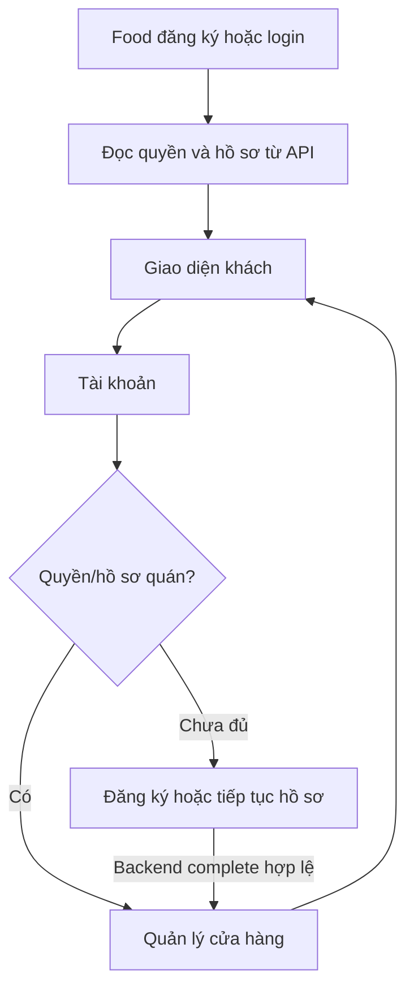

# M01 - Tài khoản, Auth và phân quyền

Version 2.0.2; **DESIGN_CANDIDATE**, nghiệp vụ 1 Web + 2 App và reset kế thừa Owner; contract mở ghi tại [decisions](06-decisions-and-gates.md). [Revision USER Admin/SMS test](09-m01-user-admin-test-sms.md) áp dụng trước phần v2.0.0 khi có khác biệt: USER cơ bản vào M01; M01.22 cung cấp inbox OTP test; SMS vendor M12.12 ở cuối dự án. Mục tiêu: mọi màn hình tài khoản dùng API/DB thật, quyền do backend cấp, ADMIN/SYSTEM qua TOTP, từng app có local + Android/browser UAT. Dependencies: M00-PC, reviewed Admin slices, migration/fixture guard, M02 geofence prerequisite cho complete quán.

## 1. Kiểm kê

| Nhóm | Đã có | Thiếu | Cần sửa / Bổ sung |
|---|---|---|---|
| Register/login/OTP/me | A1 main | CUSTOMER và UI thống nhất | Additive client-auth adapter; giữ API cũ |
| Shop/driver onboarding | A2 main | UI, DRIVER read/resume | Không tự ACTIVE từ app |
| Privileged Auth | Main f90b78a có Admin Auth/Web/TOTP | UAT, recovery/security policy toàn diện | Reuse cookie/TOTP, không nhập SMS thay TOTP |
| Invitations/activation | Main f90b78a có provisioning/activation và Admin screens | Hồi quy, UAT và tích hợp các slice mới | Reconcile scope domain với 2 app phân phối |
| Tài khoản/phiên | SHOP replacement | Logout thường/reset/audit account/profile | Session policy cần D02 |
| Reset | #43 Owner approved | Code/schema/CLI/email | Không có Đổi mật khẩu |
| USER trong Admin | Proposal trước ở M12.02; main chưa accounts route/API | List/detail/lock/unlock và UI theo scope | M01.29–.33; D15 cho identity lock nhiều role |
| SMS test / thật | Fake provider dev/test và activation TEST_DISPLAY main | Công cụ Owner lấy OTP; adapter vendor thật | Inbox test M01.22; vendor M12.12, không chặn M01 test |

## 2. Identity, role và router

**CHỐT**: ordinary registration ở Food hoặc Ship cấp CUSTOMER từ server. Đăng ký quán bổ sung SHOP_OWNER, giữ CUSTOMER. Driver profile bổ sung DRIVER; loại PLATFORM/EXTERNAL không cấp quyền Admin. ADMIN chỉ SYSTEM tạo; SYSTEM duy nhất, bootstrap server một lần. Tài khoản đăng ký ngoài không gửi role/driver_type/permission; parser từ chối privilege injection.

Không chọn CUSTOMER hay SHOP_OWNER thay tài khoản: ở Food mọi người vào giao diện khách; Tài khoản -> Quản lý cửa hàng mở phần quán nếu có quyền/eligibility, hoặc mở đăng ký/tiếp tục hồ sơ nếu chưa có. Quán bị disabled vẫn giữ chức năng khách nếu chính tài khoản không bị khóa. Driver PENDING/SUSPENDED vẫn được vào tài khoản để xem lý do; receive/online bị backend chặn.

Ứng dụng khác nhau không bắt đổi active role chung khi chỉ đổi tab UI: public view context do server authorize theo capability. Nếu còn dùng legacy SHOP active_role, adapter chuyển context bằng API thật và refetch /me; không lạm dụng context UI làm quyền. Không auto select role khi login response chưa xử lý lost-response. Xem mapping data tại 04.

## 3. USER: registration, login và OTP

Register form: họ tên (tối đa120 codepoints, profile thường); phone bàn phím tel; password8-128 codepoints; confirm; terms/version check box; primary Tiếp tục; link Đăng nhập. Không bắt email/bank/GPS ở form tài khoản. Name/terms là bổ sung phải có schema/record riêng; không gửi extra keys vào `/v1/auth/register` hiện hành.

Quy trình: nhập form -> request REGISTER OTP -> OTP6 số -> verify proof -> register transaction -> CUSTOMER + session -> Food home hoặc Ship driver onboarding. Name/password giữ trong memory khi đổi bước, không URL/local Storage/telemetry; password xóa khi thành công/thoát flow. Double submit register dùng cùng Idempotency-Key và body; app restart không có password/proof thì bắt đầu lại, không cache plaintext.

OTP: input đơn hỗ trợ paste/autofill `one-time-code`, trình bày 6 ô nhưng accessibility một trường; không tự verify khi mới có6 số nếu gây gửi trùng. Countdown dựa expiry/resend server response, tab resume tính lại. Resend chỉ khi cho phép, thành công thay challenge cũ; lỗi provider không coi SMS đã đến. Sai/hết hạn/đã dùng khóa theo mã hiện có. OTP không hiển thị trong public UI/log; Owner test lấy mã qua hộp SMS test local M01.22. Core verification/proof thật; kênh test không chứng minh sở hữu SĐT ngoài đời.

Login: phone/password, mắt hiện mật khẩu, Quên mật khẩu, Đăng ký; không Google, OTP login hoặc password rules nâng thêm ngoài contract. Đăng nhập thất bại: “Số điện thoại hoặc mật khẩu chưa đúng”; no existence leak. 401 session -> xóa token/PII cache, login với “Phiên đã hết hạn. Vui lòng đăng nhập lại.” Stale response sau logout không phục hồi login.

Transport web ordinary giữ opaque bearer **memory** theo nền thiết kế hiện có; F5 mất memory -> login lại là limitation PC chứ không fake persist. Chưa thêm check box Ghi nhớ đăng nhập trước native secure-storage contract. Android sau duyệt runtime giữ opaque token trong storage bảo vệ của OS; không giữ password. Web Admin cookie server flow đã có hỗ trợ F5/state.

## 4. Quán trong Food

Food Account hiển thị “Quản lý cửa hàng” theo API; role chưa cấp không làm thao tác protected. Onboarding quán 1 screen + map sheet: tên120 bắt buộc; contact_phone bắt buộc khác login phone cho phép; address_text500; Zalo160/Facebook300 tùy chọn; tọa độ pair optional để lưu nháp; service area server resolve từ tọa độ. Nút Lưu hồ sơ và Hoàn tất. Không nhập UUID/mã vùng vào form Owner.

Legacy backend còn yêu cầu area ID: chỉ nối complete sau geofence adapter/minimal area API; không giả vùng hoặc force fixed ID. Lưu draft không có GPS phải được phép theo code hiện có. UI map permission deny cho lưu draft, hướng dẫn lấy tọa độ tại quán khi complete; không chấp nhận điểm bịa từ mặc định map center. VERSION_CONFLICT refetch và hiện diff, không auto overwrite.

Complete chỉ khi backend chứng minh fields/GPS/vùng ACTIVE/membership: cấp SHOP_OWNER alias SHOP, không xóa CUSTOMER. Tài khoản hoàn tất không đồng nghĩa quán đang mở theo lịch; profile status và availability riêng. M01 màn quản lý quán là shell tài khoản/hồ sơ; thực đơn/đơn/online business thuộc M02/M09/M10.

## 5. Xế trong Ship

Sau login: nếu chưa DRIVER profile -> họ tên120 và biển số32 tùy chọn; submit `/v1/onboarding/driver` có Idempotency-Key. Kết quả EXTERNAL/PENDING, nhận vai trò DRIVER. Màn Hồ sơ chờ duyệt hiển thị trạng thái server và các bước bank/phone/wallet sẽ mở ở M03/M04; không nút tự duyệt, không “Đang hoạt động” giả.

Thiếu hiện nay: GET `/v1/driver/me` read own identity/status để resume sau cold start. Proposal ở M01 trả fields đang có, không nhúng wallet balance/bank verification giả. Đổi họ tên/biển số + bank/type/full lifecycle để M03. PLATFORM hiển thị “Xế hệ thống” trong nhãn UI, value API vẫn PLATFORM.

## 6. Privileged Web Admin

Reuse login -> PREAUTH `ENROLL_TOTP` hoặc `VERIFY_TOTP` -> SESSION -> shell, theo #34/#35. PREAUTH tuyệt đối không vào trang Admin protected. QR/secret chỉ trong enroll step, không telemetry/screenshot evidence chứa secret, không tự lặp POST TOTP sau timeout. Lost response -> GET `/admin-auth/state`; follow server; SESSION -> me; PREAUTH thì yêu cầu mã mới. Admin logout204 + clear cookies trên server; lost response đọc state, không nhận là logout thành công chỉ vì cache UI xóa.

SYSTEM invitation flow từ #41: choose scope domains CUSTOMER/SHOP/DRIVER + permissions can_view/can_review_profile/can_lock; TOTP step-up operation; create/reissue/revoke with Idempotency-Key và expected_version đúng parser. Domains này vẫn **giữ nguyên** dù CUSTOMER và SHOP cùng Food. Không tự merge thành `FOOD` làm ADMIN có thêm quyền. Quyền tài chính/config/log chưa có capability contract: chỉ SYSTEM hoặc BLOCKED theo decision, không suy từ can_view.

Activation #45: start invitation -> state -> OTP SMS -> password -> TOTP enrollment -> complete; dùng dedicated cookie __Host-11admin-act và CSRF, không route regular register. Link có secret phải remove fragment/query sau nhập token, không referer/access-log secret. Invitation revoke/expiry/conflict/complete races xử lý theo contract #44/#45; UI chưa có cần riêng task. Không gửi lời mời/email/SMS thật từ phiên thiết kế.

## 7. Reset USER và ADMIN

**CHỐT #43**: chung form phone -> OTP5 phút/one-use -> new password+confirm -> success -> login. ADMIN giữ TOTP, role/profile/status. Reset revoke **mọi** regular/admin session, PREAUTH/activation bước chờ có liên quan theo contract final; không tự activate disabled account. Không tự login sau reset. Không gửi proof REGISTER vào reset.

API mới `/v1/password-resets` tạo opaque challenge với response giống nhau dù phone không tồn tại/SYSTEM; request limit/time semantics không để enumerate. Backend purpose RESET_PASSWORD và reset grant scoped user+credential_version; commit password, revoke và audit trong cùng transaction. Hash Argon2 ngoài lock rồi recheck credential/profile/version trong lock. Exact replay complete chỉ trả acknowledgement không chứa token. UI sau lost response: không resend mutation bằng key mới; exact retry nếu contract còn replayable, hoặc về login thử password mới, không báo “mật khẩu chưa đổi” theo timeout.

Reset rate defaults tái dùng Auth5 min/60s/5 sai; API vẫn rate limit account/IP/ingress theo kỹ thuật Admin đang có, cấu hình cuối cần security review, không vô hạn. Chi tiết 04 và D05.

## 8. SYSTEM recovery và email

**CHỐT #43**: SYSTEM reset chỉ qua công cụ server; verified recovery email optional là OTP bổ sung khi đã có; mất email có emergency recovery audited. Bootstrap lại returns unchanged, không reset. TOTP không bị bỏ qua/xóa khi reset password.

Candidate CLI: target guard staging/production + separate operator credential, read identity/version -> prompt target and reason -> email OTP nếu verified -> password stdin -> transaction update/revoke/audit; no public APIserver-credential endpoint. CLI split begin/verify/commit để không giữ DB lock chờ email. Break-glass mất email cần Owner chốt operator verification/custody trước code; không tự đặt bypass. Có decision D05 nên prompt không cho Claude implement đường emergency bằng suy đoán.

## 9. Permission và account screens

| Actor | Được | Không được |
|---|---|---|
| Guest | Xem nội dung public có API, register/login/reset | Gọi ship, nhận đơn, truy cập địa chỉ/ví cá nhân |
| CUSTOMER | Account/addresses/Order own theo module | Tự cấp SHOP_OWNER/DRIVER/ADMIN |
| SHOP_OWNER | Own shop/menu/orders/create delivery | Quán khác, chọn xế/force dispatch, xóa đánh giá |
| DRIVER | Own profile/wallet, eligible accept/delivery | PLATFORM self-grant, COD ledger, admin API |
| ADMIN | Đúng domain + action permission đã cấp | Tạo ADMIN/SYSTEM, đổi policy/quỹ khi chưa có capability |
| SYSTEM | Bootstrap identity cao nhất và admin/config theo contract | Một SYSTEM thứ hai, bypass2FA bằng role selector |

UI account: profile name/phone, role labels read-only; Quản lý cửa hàng (Food); hồ sơ xế/bank (Ship đến module); reset entry; logout confirmation; settings language Vietnamese mặc định; privacy/help verified content. Không thêm change-phone/self-delete hoặc unsupported payment methods tự phục vụ trước thiết kế policy. Name edit ordinary profile không đổi name xế/bank verification.

## 10. Lỗi, tests và hoàn thành

Mã giữ nguyên: INVALID_PHONE/OTP_INVALID/OTP_EXPIRED/OTP_ALREADY_USED/OTP_RATE_LIMITED/VERIFICATION_PROOF_*/PHONE_ALREADY_REGISTERED/INVALID_CREDENTIALS/ACCOUNT_DISABLED/ROLE_NOT_AVAILABLE/SESSION_*/VERSION_CONFLICT. Added errors phải đăng ký fixed status/messages; frontend map copy theo code, no raw server exception. 429 Retry-After theo server; absence -> Retry CTA controlled, không đoán cooldown vượt quota. 500/503 báo thử lại và request_id.

Tests unit: phone VN normalize, Unicode pwd, exact parsers, router/copy/countdown/generation. Integration PG17: proof purpose/once, CUSTOMER server grant, shop alias, driver EXTERNAL, revoke/logout/reset atomic/race, admin PREAUTH deny, TOTP replay/expiry, role revoke while waiting lock, credential reset across both session stores, disabled retains disabled, upgrade/old-client regression. E2E browser+API real: registration/login/resume/expired/OTP delay/lost responses and account switch; negative DOM/HTTP privilege injection. Android: cold start/storage/logout/reinstall/device switch/keyboard/font/GPS permissions at dependent slices. SMS fixture tests never prove SMS production.

M01-TEST-ACCEPTED: Authenticator/API/DB thật, hộp SMS test M01.22 có nhãn và test local guard, đầy đủ các đường trong scope (USER Admin, native, recovery/device theo contract) PC + phone/browser và Owner chấp nhận. SMS vendor M12.12 deferred, không disable registration/reset chỉ vì thiếu vendor trong test local. Owner có thể quyết định LOCK phạm vi M01 test sau đủ gate và ghi rõ SMS thật ở M12.12; không tự suy từ CI. Production readiness cần M12.12 SMS thật và security/recovery/release gates, không test fallback. Snapshot audit không chứng nhận staging target đã có inbox.

## 11. Chia task và prompt

1. M01-CLIENT-CONTRACT: compatibility/public roles + D02/D03.
2. M01-CLIENT-BE: customer profile/consent/client-auth adapter/driver read/logout.
3. M01-FOOD-AUTH-UI và M01-SHIP-AUTH-UI: riêng PR, chung transport/components.
4. M01-ADMIN-UI: invitation list/create/reissue/revoke/scope và activation, reuse API đã code.
5. M01-RESET: ordinary/Admin reset; SYSTEM recovery riêng gated D05.
6. M01-REGRESSION/UAT: linked tests, native/SMS gates theo scope.
7. M01.22 TEST-INBOX: delivery adapter/công cụ PC trước, SMS vendor M12.12 cuối dự án.
8. M01.29–.33 USER-ADMIN: contract → read backend → read UI; mutation backend/UI sau D15. Không đợi toàn M12 để có danh sách USER.

Prompt [Claude M01](CLAUDE-M01.md) chỉ mở từng slice; [04](04-data-api.md) là hợp đồng field/path, [03](03-ui-catalog.md) là screen source. Không gộp thực đơn/ví/GPS/Order vào M01.
