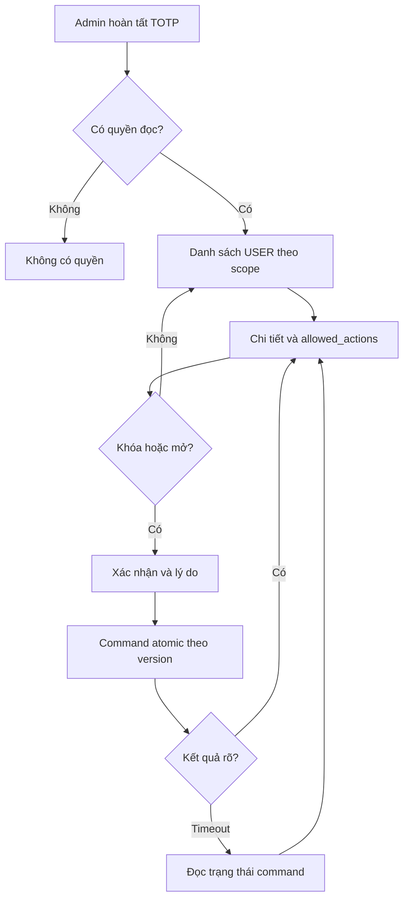
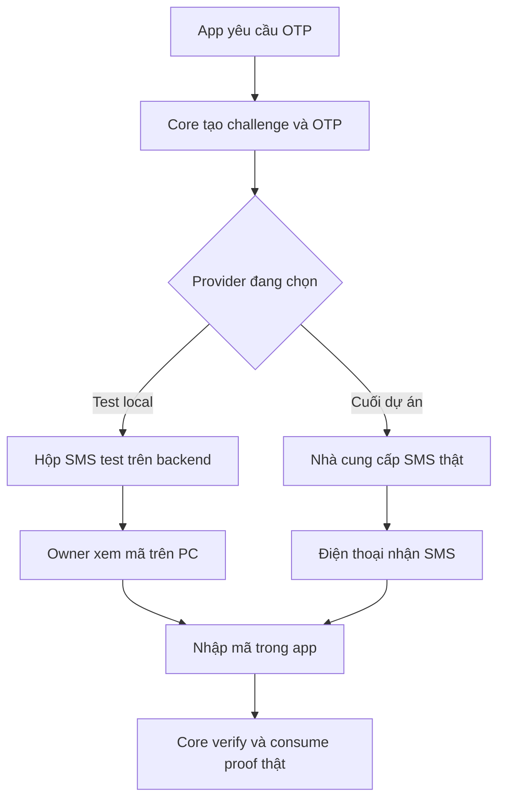

# M01 — quản lý USER trên Admin và SMS test

Phiên bản **2.0.2**, ngày **11/10/2026**, múi giờ Asia/Ho_Chi_Minh. Trạng thái **DESIGN_REVIEW / NOT_LOCKED**. Module M01; SMS nhà cung cấp chuyển sang M12.12 ở cuối dự án, trước phát hành thật. [PR thiết kế #48](https://github.com/trungtn87/11ship/pull/48); nguồn thiết kế trước sửa `80938a32b9b6fdb469346fb1183891e751a4d936`; main đã đọc `f90b78a938036aa169179185aba6adab81e6d473`.

Nguồn Owner trong phiên 11/10: “Chưa có quản lý tài khoản của user ở bên web admin nhỉ? Dịch vụ sms đưa về cuối dự an, giờ triển khai backend tự gửi sms để test”. **CHỐT:** đưa quản lý USER cơ bản vào M01 và hoãn dịch vụ SMS thật. **BỔ SUNG:** hộp SMS test trên PC, không cần gateway, OTP được tạo/kiểm tra bởi backend hiện hành. Đây là mô phỏng kênh giao mã, không gửi tin tới ứng dụng SMS của điện thoại. **CẦN OWNER DUYỆT:** UI mới và D15 về khóa toàn identity có nhiều role; không coi câu trên là phê duyệt mọi quyền quản trị mới.

ChatGPT thiết kế/review; Claude code/test/build; Owner duyệt UI, test local rồi thiết bị thật, quyết định merge/LOCK. Không có code, test vận hành hoặc nghiệm thu mới trong tài liệu này. M00 vẫn chỉ launcher/shell/test foundation.

## 1. Kiểm kê và các gói giao việc

| Nhóm | Đã có | Thiếu | Cần sửa | Bổ sung mới |
|---|---|---|---|---|
| Web Admin USER | Main có Auth, TOTP, shell và lời mời ADMIN; `core/routes.ts` chưa có accounts route | Danh sách, tìm kiếm, bộ lọc, chi tiết USER | Chức năng cơ bản đang bị xếp M12.02 | M01.29–M01.33, không tạo app quản lý |
| Identity và quyền | `app.users`, `user_roles`, `admin_memberships`, `admin_permissions`; scopes CUSTOMER/SHOP/DRIVER, view/review/lock | Contract projection và khóa toàn identity nhiều role | Không suy quyền ADMIN chỉ từ tên app 11Food | Read-only trong phạm vi hiện có; quyền mutation qua D15 |
| OTP đăng ký | `FakeOtpProvider`, 6 số CSPRNG, verify/proof/session thật | Owner không có công cụ lấy mã từ fake memory | Fake hiện chỉ dev/test, staging/production fail closed | Hộp SMS test có công cụ đọc trên PC |
| OTP kích hoạt ADMIN | FAKE và TEST_DISPLAY đã có; chế độ test chỉ development/test | Adapter dùng chung inbox với đăng ký/reset | Giữ cookie/CSRF/TOTP và accepted/rejected/unknown hiện hành | Adapter inbox, không bắt viết lại activation |
| Reset | Contract #43 đã chốt; triển khai reset phải đối chiếu head mới | Nối delivery port với inbox khi M01.16 triển khai | Không coi fake provider là bypass reset verification | Cùng hộp SMS test, purpose riêng RESET_PASSWORD |
| SMS nhà cung cấp | Port đã có; chưa có adapter thật được chứng minh trên main đã đọc | Provider/credential/recipient/budget và kiểm tra delivery | Bỏ prerequisite SMS thật của M01 test acceptance | M12.12 — gate trước production |

| Gói | Mục tiêu | Phụ thuộc | Đầu ra |
|---|---|---|---|
| [M01.22](claude-tasks/M01.22.md) | Backend và công cụ hộp SMS test, dùng core OTP hiện có | M01.01, M00.08 | Adapter REGISTER/ADMIN_ACTIVATION; port reset để M01.16 nối; runbook PC |
| [M01.29](claude-tasks/M01.29.md) | Preflight/chốt contract USER Admin và D15 | M01.01, M01.14 | Mapping quyền/DDL/API từ main; phần read có thể chốt độc lập |
| [M01.30](claude-tasks/M01.30.md) | Backend danh sách và chi tiết USER | M01.29, M01.05, M00.08 | Read API có scope/projection và phân trang |
| [M01.31](claude-tasks/M01.31.md) | Web Admin danh sách và chi tiết USER | M01.30 | D81/D86, UI được duyệt và E2E API thật |
| [M01.32](claude-tasks/M01.32.md) | Backend khóa/mở USER, audit và revoke phiên | M01.29, M01.30, M01.04 | Mutation atomic/version/idempotency; chờ D15 |
| [M01.33](claude-tasks/M01.33.md) | Web Admin xác nhận khóa/mở USER | M01.31, M01.32 | D87/D88, lý do, thông báo và xử lý kết quả chưa rõ |
| [M12.12](claude-tasks/M12.12.md) | Provider SMS thật và kiểm thử trước phát hành | M01.23, M01.22, M12.10 | Delivery thật, hồi quy OTP và evidence đúng SHA |

M01 hiện **33 gói**. M01.23 nghiệm thu cuối sau cả USER Admin và native; SMS thật nằm ngoài test acceptance M01. M12.02 giữ phần xử lý tác động vận hành/hàng/tiền và khả năng quản trị nâng cao; không viết lại API/màn hình USER của M01. M12.01 vẫn quản trị capabilities mở rộng, không chặn read cơ bản khi M01.29 đủ contract.

## 2. Nghiệp vụ và UI/UX quản lý USER

### 2.1. Phạm vi tài khoản

USER là identity dùng SĐT đăng ký; CUSTOMER, SHOP_OWNER và DRIVER là role nghiệp vụ. Danh sách nhóm **Tài khoản → Người dùng** không bao gồm SYSTEM/ADMIN; loại trừ cả `account_origin=ADMIN_PROVISIONED` lẫn identity có `admin_memberships`, kể cả membership DISABLED. Quyền chỉ dựa trên dữ liệu server. Không thêm tạo USER hộ, sửa SĐT đăng nhập, đặt mật khẩu hộ, cấp role trực tiếp, xóa vật lý hoặc sửa tên pháp lý/bank.

Khóa `users.status` tác động cả identity trên hai app; không đồng nghĩa đình chỉ hồ sơ quán/xế. Mở khóa giữ nguyên role, trạng thái hồ sơ, chứng minh ngân hàng, số dư và các điều kiện vận hành. Phiên đã revoke không sống lại; người dùng đăng nhập lại. ADMIN/SYSTEM không được xem password hash, OTP/proof, token, secret TOTP hoặc dữ liệu ngân hàng/GPS trong màn USER.

### 2.2. Quyền đọc và mutation

| Actor | Đọc USER | Khóa/mở identity |
|---|---|---|
| Guest, PREAUTH, CUSTOMER/SHOP_OWNER/DRIVER | Không; gọi thẳng HTTP cũng bị từ chối | Không |
| SYSTEM hoàn tất TOTP, membership/session ACTIVE | USER thường; tất cả projection nghiệp vụ trong scope này | Đề xuất được thao tác USER thường sau D15, không SYSTEM/ADMIN |
| ADMIN có `can_view` ở domain | Chỉ USER có domain giao với scope; chỉ phần hồ sơ thuộc domain đó | Đề xuất cần `can_view` + `can_lock` cho **mọi domain đang thuộc identity**; chờ D15 |
| ADMIN không có view, bị disable/revoke hoặc session hết hạn | Không; kiểm lại quyền khi đọc | Không |

SHOP_OWNER public ánh xạ domain/storage SHOP. CUSTOMER có trên cả người đăng ký quán/xế: ADMIN CUSTOMER không vì thế được đọc hồ sơ xế, bank hoặc khóa toàn identity có DRIVER. USER legacy chưa có role chỉ SYSTEM được xem. Quyền review profile không được dùng thay quyền lock. M01.29 phải ghi riêng lock identity và suspend profile, sau đó Owner quyết định D15; phần read không đợi quyền tiền/config/export của M12.

### 2.3. Màn hình và thành phần

| ID/route | Nội dung | Thao tác và trạng thái |
|---|---|---|
| D81 `/accounts/users` | Breadcrumb, tiêu đề Người dùng; tìm SĐT hoặc tên; role filter Khách/Chủ quán/Xế theo scope; ACTIVE/DISABLED; ngày đăng ký từ/đến; Áp dụng, Xóa lọc; bảng tên/SĐT/role được xem/trạng thái/ngày tạo/Xem | Mỗi USER một dòng dù nhiều role. Tìm kiếm submit Enter/nút, bỏ request cũ khi filter đổi. Phân trang cursor, trang kế/trước giữ bộ lọc; không total giả. Không nút tạo/xóa/export. |
| D86 `/accounts/users/:id` | Họ tên có thể chưa cập nhật, SĐT, ID, ngày tạo/cập nhật, trạng thái identity; nhãn role được xem; các khối hồ sơ khách/quán/xế chỉ trong scope; trạng thái hồ sơ riêng; version | Quay lại giữ filter/scroll. Làm mới; timeline chỉ các sự kiện quản lý USER được phép, không audit toàn hệ thống. Khóa hoặc Mở khóa từ allowed_actions; client không tự tính quyền. |
| D87 xác nhận khóa | Tên/SĐT mục tiêu, cảnh báo mất phiên của cả hai app, lý do 1–500 codepoints sau trim, Hủy/Khóa tài khoản | Disable trong request; Enter không tự xác nhận nguy hiểm. Vòng focus trong dialog, Escape đóng trước submit; sau submit chưa rõ chỉ đọc lại/truy hồi command, không phát ý định mới. |
| D88 xác nhận mở | Mục tiêu, lý do, giải thích chỉ mở identity và yêu cầu login lại, Hủy/Mở khóa | Không tự ACTIVE hồ sơ quán/xế hoặc hoàn tiền. Thành công refetch detail, không sửa badge lạc quan trước server. |

Màu/token/font/logo kế thừa catalog03; không vẽ logo mới. CTA chính vàng, text đen; destructive action có icon/copy rõ và dialog xác nhận. PC1366 và 1024 có bảng vừa trang; ở viewport nhỏ chuyển card/khối thông tin, không cắt nút. Control cao ít nhất44px, label/focus/keyboard đầy đủ. [Board UI](assets/m01-user-admin-v2.0.2.svg) là mẫu duyệt, dữ liệu trên board chỉ placeholder **DEMO THIẾT KẾ**, không record thật.

Loading: skeleton và `aria-busy`, không hiện empty trước khi có response. Empty toàn danh sách: “Chưa có tài khoản người dùng”; empty filter: “Không tìm thấy tài khoản phù hợp” + Xóa lọc. Offline/timeout: giữ bộ lọc, gỡ dữ liệu sau mất quyền, hiện Lấy lại dữ liệu; không tự chạy mutation. 401 về Auth Admin, 403 màn Không có quyền, ID không xem được trả cùng unavailable với ID không tồn tại. Thành công: “Đã khóa tài khoản. Các phiên đăng nhập đã bị thu hồi.” / “Đã mở khóa tài khoản. Người dùng cần đăng nhập lại.”

## 3. Luồng thao tác





## 4. Thiết kế dữ liệu và API USER

### 4.1. Đọc dữ liệu

Các endpoint dưới đây là **proposal additive**, chưa tồn tại trên main đã đọc. Prefix API `/v1/admin/users`; client route `/accounts/users`. Auth cookie/Origin/CSRF và transport kế thừa Admin hiện có, không bearer USER truy cập Admin. Response envelope giữ cấu trúc `data`/error/request_id của repo. Không đổi endpoint `/v1/auth`, `/v1/client-auth`, lời mời hoặc parser legacy.

| Method/path | Request | Response data | Lỗi |
|---|---|---|---|
| GET `/v1/admin/users` | `q?`, `role?=CUSTOMER\|SHOP_OWNER\|DRIVER`, `status?=ACTIVE\|DISABLED`, `created_from?`, `created_to?`, `limit=20` (1–100), `cursor?` | `items:[UserSummary]`, `next_cursor:string\|null`, `applied_filters`, `available_role_filters`, `evaluated_at` | 400 validation/cursor; 401 Admin session; 403 scope; 429 limit; 503 read unavailable |
| GET `/v1/admin/users/:user_id` | UUID, không extra query | `UserDetail` gồm version và allowed_actions | 400 UUID; 401; 404 USER không tồn tại hoặc ngoài phạm vi; 503 |
| GET `/v1/admin/users/:user_id/account-events` | limit/cursor | Timeline account lock/unlock được phép: action, reason, actor display, timestamp, command_id | 401/404/400; không lộ audit payload/PII ngoài scope |

`UserSummary`: `user_id`, `display_name:string|null`, `phone_display` (SĐT VN cho identity trong view scope), `roles_visible`, `account_status`, `created_at`. `UserDetail` thêm `updated_at`, `version` (số nguyên dương an toàn theo mapper hiện hành), các `profiles` thuộc scope, `allowed_actions` chỉ READ/LOCK/UNLOCK thực sự đã được backend authorize. Không dùng số0 hoặc tên giả cho dữ liệu chưa có. Không gửi toàn roles/profiles rồi nhờ frontend che.

Tìm SĐT chuẩn hóa VN hiện hành, tên không dấu/case-insensitive trong `customer_profiles.full_name` sau M01.02; dấu/hoa giữ ở display. q trim, tối đa120 codepoints; escaped literal search, query parameterized. Không tìm/để lộ legal driver name ngoài DRIVER scope. Filter ngày dùng ISO date với biên Asia/Ho_Chi_Minh, `from` đầu ngày inclusive, `to` cuối ngày bằng exclusive đầu ngày kế tiếp; from>to bị400. Cursor bounded opaque, keyset `(created_at,user_id)` desc, ràng filter và actor permission version; quyền đổi cursor cũ bị invalidate, không lộ count ngoài scope. Có pagination next_cursor, không COUNT đại trà.

### 4.2. Dữ liệu và migration

Nguồn thật: `app.users` có status ACTIVE/DISABLED, `version bigint`, phone_normalized, timestamps, account_origin PHONE_VERIFIED/ADMIN_PROVISIONED; `app.user_roles`; `app.admin_memberships`; `app.admin_permissions` có can_view/can_review_profile/can_lock. `customer_profiles` do M01.02 bổ sung, shop/driver profile từ owner module. Origin không thay membership authorization. M01.30 không tạo bảng accounts trùng users, không sửa migration đã áp dụng.

Index append-only nếu EXPLAIN trên dataset phù hợp chứng minh cần: users `(created_at DESC,user_id DESC)` và status+pagination; role lookup đã có thì reuse; name search index chỉ sau đánh giá extension/compatibility/grants, không tự bật extension production. Query role dùng EXISTS/aggregation tránh duplicate USER. Contract .29 pin tên PK/column/grants thực trước code. Mutation cần idempotency/replay cùng core, audit/outbox transaction; có thể thêm command read metadata trong namespace M01 nếu core chưa phục vụ lookup không secret. Physical DDL của command store, PK/FK/check/index/retention/grants phải được ChatGPT chốt trong .29, không cho .32 tự nghĩ schema theo đoạn proposal này.

### 4.3. Khóa và mở — chờ D15/contract gate

POST `/v1/admin/users/:user_id/lock` hoặc `/unlock`, header Idempotency-Key, body chỉ `{expected_version,reason}`. Expected version là số nguyên dương an toàn; reason1–500 codepoints sau trim. Response acknowledgement `{command_id,user_id,account_status,version,changed_at}`; không session token. GET `/v1/admin/user-account-commands/:command_id` trả same acknowledgement hoặc PENDING/FAILED theo contract được chốt, scope chỉ actor/capability hợp lệ.

Lock order phải được .29 đối chiếu với Auth/provisioning hiện tại: serialize actor revocation, target users/roles, target sessions theo thứ tự duy nhất; không tự copy lock order SYSTEM-only rồi mở thành ADMIN. Kiểm session/membership/factor/capability sau lock và clock mới. Lock: users ACTIVE→DISABLED, increment version, revoke **mọi phiên thường của identity**, audit/outbox cùng transaction. Nếu target có admin membership, bị loại trước mutation. Unlock: DISABLED→ACTIVE, increment version; không phục hồi phiên cũ. Sai version409; same key/body replay acknowledgement không double audit; key/body khác409; replay luôn recheck quyền hiện tại. Login/context/command race phải serialize đúng user để login không tạo phiên sống sau lock.

M01 không thao tác Order/Delivery/wallet. Trước bật mutation trên tài khoản có hàng/hold/nghĩa vụ vận hành, M12.02 phải có impact port/case đã review; không force-cancel, trả tiền hay bỏ custody bằng lock. Trong gói .32 chỉ kiểm M01 isolated/local test với điều kiện không có nghiệp vụ active được chứng minh; trạng thái impact UNKNOWN phải từ chối, không xem như sạch. UI chỉ hiển thị hành động khi backend xác nhận action đủ quyền/guard. D15 chốt chính sách nhiều role và xử lý đang vận hành trước rollout mutation rộng.

Mã lỗi proposal thêm phải đăng ký trong error registry hiện có: USER_NOT_AVAILABLE(404), USER_ACCOUNT_VERSION_CONFLICT(409), USER_ACCOUNT_ALREADY_IN_STATE(409), USER_ACCOUNT_IMPACT_REVIEW_REQUIRED(409), USER_ACCOUNT_COMMAND_UNKNOWN(404). Reuse Admin session/CSRF/forbidden và idempotency codes đã có thay alias tùy tiện. Contract .29 phải xác nhận exact codes/status/copy/replay TTL trước .30/.32. Unknown timeout không suy failed; GET detail chỉ chứng minh trạng thái hiện tại, command lookup mới chứng minh intent đã commit.

## 5. Backend hộp SMS test — M01.22

### 5.1. Cách chạy và giới hạn

Chế độ server explicit **TEST_INBOX**, chỉ `APP_ENV=development|test` trên target test local được guard. Mặc định và cấu hình thật không silently fallback. Staging/production phải từ chối TEST_INBOX, giữ hành vi fail-closed hiện tại khi chưa có SMS adapter. Không đổi APP_ENV của server từ xa để lách guard. Gói này phục vụ PC và Android nối backend test local; phone dùng mạng/TLS được duyệt, Owner đọc mã trên PC. Inbox từ xa không public: nếu cần remote OTP fixture, thiết kế gói riêng được Owner duyệt.

Backend sinh OTP6 số CSPRNG theo core, giữ challenge TTL/resend/wrong-attempt/one-use/digest/proof/rate/transaction semantics hiện có; test channel chỉ thay delivery adapter. REGISTER và ADMIN_ACTIVATION dùng port đang có; RESET_PASSWORD nối bằng port của .16. Không thử reset SYSTEM qua SMS; không SMS thay TOTP. Không chọn OTP cố định, luôn-đúng hoặc verify tự động. Không thêm mã OTP vào response public REGISTER/reset/me, không mở test_code dựa trên header/query client. TEST_DISPLAY activation cũ vẫn chỉ explicit dev/test để tương thích; default M01 Owner test mới dùng inbox.

Một `TestSmsInbox` **in-memory trong backend** nhận bản tin từ ba adapter. Mỗi bản tin có `message_id` (CSPRNG UUID), `purpose=REGISTER|RESET_PASSWORD|ADMIN_ACTIVATION`, `phone_normalized`, `otp`, `received_at`, `channel=SIMULATED_SMS`. Nhãn là đã vào inbox, không phải DELIVERED tới mạng viễn thông hoặc proof phone possession. Không thêm dữ liệu inbox vào DB nghiệp vụ/audit/outbox/log. Giữ tối đa100 bản tin, tự bỏ sau10 phút hoặc khi dừng backend; đây là retention của hộp test, **không thay expiry OTP trong DB**. Provider port legacy không có challenge_id/expiry thì không tự đoán hay giả correlation; app đọc expiry thật từ challenge response, core quyết định mã còn hợp lệ hay không.

### 5.2. Công cụ Owner và boundary kỹ thuật

Backend mở listener **loopback127.0.0.1** riêng trên port OS cấp ngẫu nhiên, chỉ khi TEST_INBOX bật. Không dùng public API port, không route qua proxy Admin/Food/Ship, không bind0.0.0.0, CORS disabled. Token đọc256bit mới mỗi lần chạy; file state thuộc đúng backend PID/start time/repo, ngoài Git với quyền chỉ current OS user. Nếu không thiết lập ACL/chmod private hoặc bind loopback được thì fail startup, không degrade. Tool không truyền token/OTP trên argv/URL; token đọc từ file private và gửi Authorization header. Không xuất token vào output hoặc evidence.

Contract tool riêng, không phải Backend API sản phẩm:

| Method/path trên listener local | Quyền/request | Response |
|---|---|---|
| GET `/messages` | Bearer token riêng; purpose optional, phone filter optional theo normalizer, limit1–20 default20 | data.items gồm message_id/purpose/phone_masked/received_at/channel; không OTP trong list |
| GET `/messages/:message_id` | Cùng token; message chưa purge | data gồm message fields và otp để **công cụ operator hiển thị có chủ đích** |

401 token sai/thiếu;404 không có/đã purge;400 parser;429 quota đọc60 request/phút với burst10/token. No-store/no-cache, không redirects, không log body/Authorization/OTP/phone. Request Origin browser bị từ chối; tool CLI không Origin, không browser client tùy ý. Bộ lọc chỉ dùng số test Owner nhập trong runbook; không nhập vào Git hoặc telemetry. Actual numbers/OTP trong screenshot phải che trước evidence.

`tools/local/11ship-test-sms.cmd` và helper CLI là **tiện ích test**, không app/web sản phẩm thứ tư và không thay ba launcher. Owner double-click để mở cửa sổ “SMS TEST — KHÔNG GỬI SMS THẬT”, chọn bản tin mới nhất theo phone/purpose và xem mã; không phải gõ lệnh mỗi lần. Chạy lại tool có thể reconnect backend owned mới; backend restart làm hết inbox, thông báo gửi lại OTP theo cooldown thật. Không auto resend từ tool; không button verify/reset/login hộ. Tool chỉ hiển thị, không ghi lịch sử mã ra file. Sửa launcher chỉ wiring/config test được chỉ rõ, không mở rộng M00.

UI Auth ở môi trường test có banner server-configured “SMS mô phỏng — môi trường test”; copy request thành công “Đã tạo OTP test. Mở hộp SMS test trên PC để lấy mã.” Chế độ thật cuối dự án dùng copy gửi SMS hiện hành; không hiển thị OTP ngay trên màn Auth công khai. Người test tự nhập mã vào Food/Ship/activation/reset. APP_ENV/test mode là server config, frontend không được gửi để bật.

### 5.3. Send outcome và reset integration

REGISTER port chỉ resolve sau inbox append thành công, reject theo timeout hiện tại; activation adapter giữ outcome ACCEPTED/REJECTED/UNKNOWN, không biến unknown thành rejected. Provider call ngoài DB transaction/lock; append rồi mất response vẫn có message nhưng core challenge mới là authority. Adapter reset chỉ nhận DTO server internal của .16, không cung cấp endpoint gửi tùy số/purpose. Fault injection chỉ automated isolated tests, không public endpoint/bypass. Không retry tự động một OTP send chưa rõ outcome nếu contract hiện hành cấm; app dùng state/cooldown server.

M01.22 có thể làm trên core main hiện có, không đợi .03/.15/.16 hoàn thành; .03/.15/.16 reuse transport/adapters và test khi đến gói. Không đánh dấu reset path đã code hoặc PASS chỉ vì inbox có generic purpose. OTP test có thể kiểm full challenge/proof/registration/reset, nhưng **không chứng minh sở hữu SĐT ngoài đời**. DB local test/fixture được phân biệt với production; không chuyển các identity đã verify bằng kênh mô phỏng vào production. Không thêm timestamp giả cho account chưa qua core verification.

## 6. Tình huống lỗi và nghiệm thu

| ID | Ca test | PASS |
|---|---|---|
| UA01 | USER thường, nhiều role, account ADMIN/SYSTEM, membership DISABLED | USER mỗi dòng một lần; privileged loại khỏi list/detail/mutation |
| UA02 | ADMIN CUSTOMER/SHOP/DRIVER view khác nhau, gọi ID/filter ngoài scope | Server projection và list scope đúng; không leak hồ sơ/tổng/sự tồn tại ngoài phạm vi |
| UA03 | Revoke membership/factor/session khi list/command đang chờ lock | Quyền được kiểm lại; không stale authorization commit |
| UA04 | Query tên có dấu/không dấu, SĐT VN, ngày biên, cursor đổi filter/quyền | Search chính xác, stable keyset, ngày local đúng, parser từ chối cursor sai |
| UA05 | Loading/empty/filter/offline/timeout/401/403/404/429 | Copy/CTA/loading đúng; state cũ không lộ PII sau mất quyền |
| UA06 | Lock đồng thời login/context và exact retry; fault rollback | No live session sau lock; user/version/audit/outbox atomic, không double effect |
| UA07 | Unlock disabled profile; old token; reset account disabled | Mở identity không đổi hồ sơ/bank/funds, old sessions vẫn revoked, reset không tự mở |
| UA08 | Lock target nhiều role, privileged hoặc impact UNKNOWN | Theo D15; từ chối thiếu quyền/guard; không cancel hàng hoặc sửa ví |
| TS01 | REGISTER trên Food/Ship với số test do Owner cấp | Mã ngẫu nhiên nhận trong inbox; tự nhập mã, core proof/register thật; không public OTP |
| TS02 | RESET_PASSWORD và ADMIN_ACTIVATION khi gói đó đã triển khai | Đúng purpose/once/expiry/rate; giữ TOTP/reset revocation; đường chưa code ghi chưa chạy |
| TS03 | Sai OTP5 lần, expiry, resend cooldown, proof used/wrong purpose, double click | Core behavior như trước, inbox không làm bypass hoặc reset attempts |
| TS04 | Provider reject/timeout/unknown/lost response và backend restart | Outcome đúng core; không fake phone delivery; tool reconnect, old messages không sống lại |
| TS05 | Production/staging hoặc TEST_INBOX thiếu guard/private ACL | Startup fail closed; test listener không mount; không fallback fake |
| TS06 | Token thiếu/sai, browser Origin, listener từ mạng ngoài, rate/parser/purge | Denied/no-store/loopback-only; secrets không log/repo/ảnh |
| TS07 | Owner PC rồi Android nhập mã lấy trên PC | API/DB thật, đúng version/SHA; keyboard/lifecycle/resend/network theo app; chưa chứng nhận telecom |
| RS01 | M12.12 SMS provider trước production | SMS thật đến điện thoại, thời hạn/send outcome/không có test listener, hồi quy cả ba luồng |

Claude: unit parser/projection/router/inbox TTL/guard; integration PG17 auth/revoke/race/atomic rollback/permissions; browser E2E Admin và từng flow Auth qua API/DB thật; Windows double-click tool/ACL; Android khi local được Owner chấp nhận. Fresh/upgrade/grants/old-client regression nếu có migration/API change. Tests phá dữ liệu chỉ TEST5433, không DEV5432/staging. Không chạy test mới ở gói docs này.

Owner actual mọi ca **Chưa chạy**. **M01-TEST-ACCEPTED** có thể được Owner chấp nhận sau PC + phone + USER Admin + Authenticator/backend thật, với SMS mô phỏng được ghi rõ. SMS thật là deferred release gate M12.12; không gọi test acceptance là production ready. Owner có thể LOCK phạm vi M01 test khi đủ gate và quyết định được ghi rõ; SMS thật vẫn là release gate riêng, không tự LOCK trong gói docs. Recovery D05/device/runtime D02/D03/UI/permissions còn mở vẫn chặn đúng slice, không vì hoãn SMS mà bỏ qua. M01.23 không phụ thuộc M12.12 để tránh cycle; M12.12 kiểm lại Auth đã test khi nối SMS thật.

## 7. Prompt Claude và file scope

Giao **một gói mỗi lần**, dùng file gói trong bảng §1. Có thể ưu tiên .22 sau preflight/đủ dependency để Owner lấy mã test; USER read đi .29→.30→.31; mutation .32→.33 sau D15. Không giao tất cả gói bằng lệnh này.

```text
Đọc AGENTS.md, docs/process/11ship-delivery-workflow.md và gói M01.xx được giao trong docs/design/system-v2-20261011/claude-tasks. Thiết kế áp dụng v2.0.2 tại PR48 và 09-m01-user-admin-test-sms.md; fetch main/design/dependency, ghi full SHA và diff mới. ChatGPT docs/review; Claude product code/tests; Owner UI/local/phone/merge/LOCK.
Làm đúng một gói trên branch riêng, Draft PR. Giữ API legacy và migration append-only; không fake business data/quyền/mật khẩu hoặc bypass OTP/TOTP. M01.22 chỉ delivery test explicit dev/test local, không public OTP/log secrets, không SMS vendor. Các gói USER dùng users/memberships/scopes hiện hành; SYSTEM/ADMIN target ngoài USER API. Read không mở quyền lock; mutation chờ D15/contract. M12.02 không viết lại USER M01.
M01.22: core OTP/expiry/proof/attempts giữ nguyên; implement inbox + separate loopback token boundary + double-click read tool, wire REGISTER/ADMIN_ACTIVATION đang có; .16 nối RESET sau. Chỉ ghi PASS đường đã có code và đã chạy; không viện generic purpose để nhận reset hoàn thành.
USER: paths dự kiến apps/backend/src/admin-users/, apps/admin-web/src/core/user-accounts-{api,controller}.ts, apps/admin-web/src/dom/user-accounts-view.ts, routes.ts/shell-app.ts, tests/admin-web/, tests/integration/. .29 map path thật và contract trước code; .30 read backend, .31 read UI, .32 mutation, .33 confirm UI riêng PR. UI D81/D86/D87/D88 phải được Owner duyệt trước code.
OTP: paths dự kiến apps/backend/src/test-sms/, auth/otp-provider-binding.ts, admin-activation/activation-otp-providers.ts, config theo repo; tools/local/11ship-test-sms.cmd, scripts/test-sms-inbox.mjs, runbook/evidence tương ứng. Giữ current FAKE/TEST_DISPLAY compatibility/production fail-closed. Không thay deployment/server APP_ENV hoặc public proxy để phơi OTP.
Trả changed files, contract/migration notes, exact final SHA, tests/CI links, ảnh che dữ liệu nhạy cảm, runbook chạy PC và checklist expected/actual. Owner actual để Chưa chạy. Không tự chuyển gói, merge/deploy production/LOCK hoặc sửa tay PROGRESS/plan.yml.
```

## 8. Quyết định và trạng thái

| ID | Trạng thái | Áp dụng |
|---|---|---|
| C12 | Owner yêu cầu: quản lý USER cơ bản ở M01 | M01.29–.33; M12.02 không trùng core |
| C13 | Owner yêu cầu: SMS vendor ở cuối dự án, backend có kênh test trước | M01.22 TEST_INBOX; M12.12 thật trước release; D04 SMS provider không chặn M01 test |
| D15 | Cần Owner duyệt policy khóa identity nhiều role, quyền can_lock và guard tác động vận hành | Chỉ chặn .32/.33 và rollout mutation; không chặn list/detail/inbox |
| UI D81/D86/D87/D88 | Mẫu đã thiết kế, chưa được ghi Owner duyệt | Chặn code UI mới theo workflow; backend/preflight độc lập được tiến hành khi đủ contract |

Không thu phí SMS/đăng ký vendor/mở thêm quyền/config production trong bản sửa này. D04 map/geometry/push/bank vẫn áp dụng đúng module; D05 SYSTEM recovery không bị thay thế. Mọi quyết định Owner mới phải ghi nguồn/phiên bản và test lại phạm vi bị ảnh hưởng.
