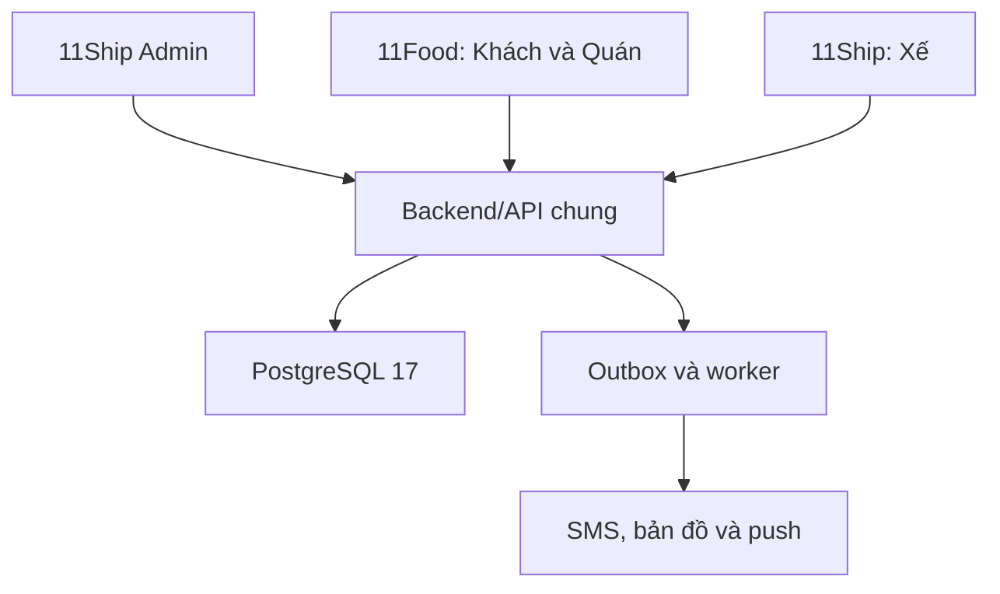

# 11Ship - Thiết kế hệ thống 1 Web + 2 App

Phiên bản **2.0.0**, ngày **11/10/2026 (Asia/Saigon)**. Trạng thái **DESIGN_REVIEW / NOT_LOCKED**. Base kiểm kê: `e5b50e8567b8928646c83648dd70f577915dc14f`. Quyền thiết kế: nhiệm vụ Owner ngày 11/10/2026. ChatGPT thiết kế và review; Claude code/test/build; Owner duyệt UI, test và quyết định merge/LOCK.

PR thiết kế [#48](https://github.com/trungtn87/11ship/pull/48), nhánh `docs/three-app-system-design-20261011`, trạng thái Draft. PR này lưu bộ bàn giao; việc tạo PR không thay thế phê duyệt UI hoặc nghiệm thu module.

## Cách dùng bộ bàn giao

1. Đọc [kiểm kê](00-audit.md), [quyết định/độ sẵn sàng](06-decisions-and-gates.md).
2. Làm **M00 trước** theo [đặc tả](01-m00.md), [bảng màn hình](03-ui-catalog.md), [prompt Claude](CLAUDE-M00.md) và [checklist Owner](M00-UAT.md).
3. Làm M01 theo [đặc tả](02-m01.md), [hợp đồng dữ liệu/API](04-data-api.md) và prompt riêng [Claude M01](CLAUDE-M01.md).
4. M02-M12: [thiết kế theo module](05-m02-m12.md). Các API mới ở đây là **hợp đồng đề xuất**, không phải endpoint đang có. Slice chạm chính sách còn xung đột phải qua gate quyết định trước khi code.
5. [Chỉ mục nguồn](07-source-index.md) liên kết module/PR/commit và ảnh review.
6. [Snapshot PR/CI](audit-snapshot.json) ghi SHA và bằng chứng tại thời điểm audit. Luôn refresh head khi giao code/review; không lấy tài liệu này làm chứng nhận CI hoặc UAT của head mới.

## Nguồn và thứ tự ưu tiên

Chỉ đạo Owner trong nhiệm vụ này > quyết định Owner mới đã ghi nguồn > contract hiện hành không mâu thuẫn > code để xác định hiện trạng > proposal cũ. Có code không có nghĩa nghiệp vụ khác đã được Owner duyệt. Không sửa chứng cứ lịch sử.

**CHỐT**: quyết định đã có nguồn Owner, hoặc invariant đã merge không bị thay thế. **BỔ SUNG**: chi tiết UI/kỹ thuật do ChatGPT hoàn thiện trong ủy quyền. **CẦN DUYỆT**: thay đổi chính sách/quyền/bảo mật/tiền/kiến trúc hoặc xung đột nguồn. **ĐÃ CÓ** luôn ghi rõ trên main hay chỉ PR.

## Kiến trúc hiện hành

| Bề mặt | Người dùng | Phân phối |
|---|---|---|
| 11Ship Admin | SYSTEM / ADMIN | Một Web; không có app quản lý riêng |
| 11Food | CUSTOMER và SHOP_OWNER | Một app Android; khách/quán chung package |
| 11Ship | DRIVER | Một app Android; PLATFORM/EXTERNAL là loại xế |

Cùng một backend NestJS/Node 24 và PostgreSQL 17, opaque session, transaction/idempotency/audit/outbox hiện có. Client chỉ gọi API, không truy cập DB trực tiếp. PC là runtime web để sửa nhanh và kiểm luồng; không chứng minh GPS nền/push/Keystore/Android lifecycle đã đạt.

## Điều chỉnh tài liệu cũ khi triển khai

- Thay mô tả phân phối tại brand guideline §1.1/6.2/7.4/9.3; giữ nguyên logo, màu, font, slogan. SHOP chuyển về 11Food; DRIVER ở 11Ship.
- Reconcile PR #28/#30/#31/#33: chỉ ba bề mặt, không xóa chức năng quán hoặc quyền quản trị.
- PR #43 đã chốt **reset mật khẩu**, không tạo màn hình Đổi mật khẩu. ADMIN vẫn dùng TOTP khi đăng nhập lại.
- Không sửa tay `docs/PROGRESS.md`; parser/dashboard hiện chưa thể hiện đầy đủ gate. Không tự sửa `plan.yml` schema v1 hoặc nhận toàn module DONE.

## Phạm vi sẵn sàng

| Nhóm | Thiết kế | Được bắt đầu |
|---|---|---|
| M00 launcher/shell/diagnostics | Chi tiết, có file/task/test và UI | Sau duyệt UI theo workflow và chuẩn bị đúng dependency Admin |
| M01 Auth hiện có / reset / khách-quán | Chi tiết proposal tương thích | Theo từng prompt, sau các gate quyền/phiên/restore liên quan |
| M02-M12 | Bao phủ nghiệp vụ, màn hình, state, API/data proposal, test và prompt slice | Chỉ slice đủ contract và hết quyết định chặn |
| Native Android/phát hành thật | Đã xác định yêu cầu và gate | Chờ chốt runtime/provider/release; không phát hành trong bộ thiết kế này |

Không tuyên bố đã chạy app, đã kiểm DB từ xa, đã deploy hoặc Owner đã nghiệm thu. M00 có mốc PC riêng; LOCK toàn M00 tuân thủ gate thiết bị thật hoặc quyết định Owner ghi rõ phạm vi áp dụng.
